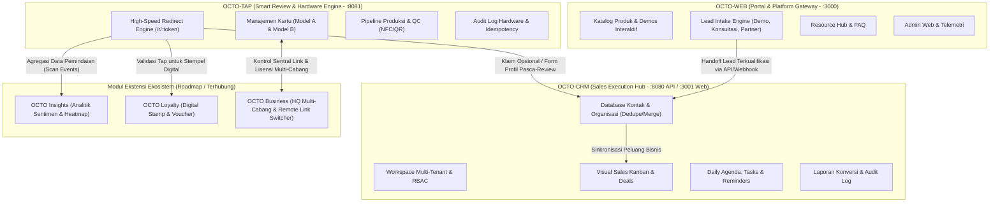
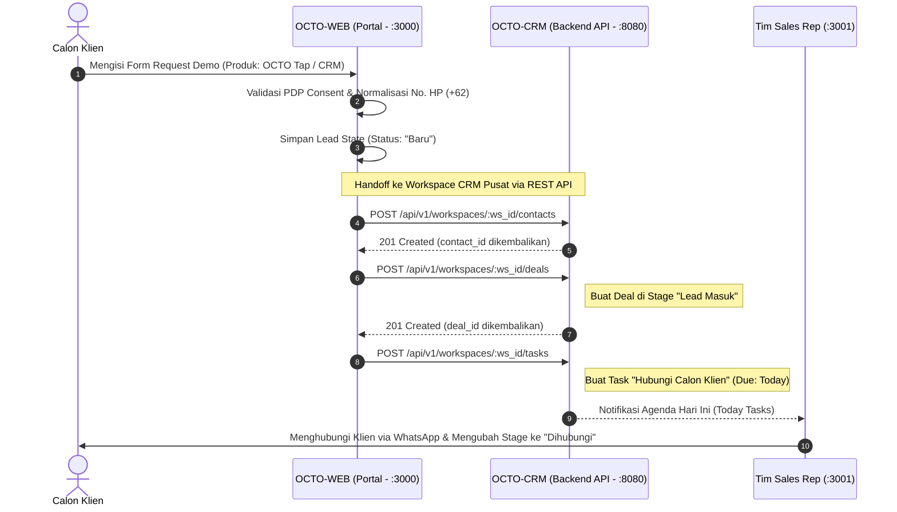

# OCTO CRM — ULTIMATE PRODUCT REQUIREMENTS DOCUMENT
**Know Your Customers. Grow Your Relationships.**  
*Master Brand*: OCTO — ONE PLATFORM. MANY POSSIBILITIES. Smart business tools, connected.  
*Dokumen Versi*: 2.0 (Ultimate Scope & Master Ecosystem API Alignment) | Tanggal: 19 Oktober 2026  
*Status*: Blueprint Spesifikasi Target Produk & Kontrak Integrasi Ekosistem  
*Rujukan Utama*: `OCTO_ECOSYSTEM_API_MASTER_DOCS.md` (Versi 1.0.0 Master Release)

---

> **Prinsip Utama Dokumen**: Dokumen ini adalah cetak biru target produk lengkap (*Ultimate PRD*) yang diselaraskan secara penuh (*100% aligned*) dengan **OCTO Ecosystem Master API Contracts**. Setiap kapabilitas, port komunikasi, skema payload, dan titik integrasi lintas produk dikategorikan dalam status **Live**, **Beta**, atau **Planned**.

---

## 1. Executive Summary & Topologi Ekosistem OCTO

### 1.1 Product Overview: The Unified Customer Truth
OCTO CRM adalah platform Customer Relationship Management (CRM) multi-tenant modern berbasis Software-as-a-Service (SaaS) yang bertindak sebagai **pusat eksekusi relasi pelanggan dan pipeline penjualan** dalam ekosistem OCTO. OCTO CRM dirancang untuk mengelola siklus hidup interaksi pelanggan secara utuh: mulai dari prospek awal (*leads*), organisasi/perusahaan (*companies*), kontak individu (*contacts*), peluang kesepakatan bernilai moneter (*deals/pipelines*), catatan aktivitas dan komunikasi (*activities*), tindak lanjut harian (*tasks & follow-ups*), segmentasi dinamis (*segments*), hingga pelaporan metrik konversi (*reporting*).

Ekosistem OCTO dirancang dengan prinsip **modular, terisolasi secara multi-tenant, dan terhubung melalui kontrak data terstandar**. Setiap produk memiliki domain tanggung jawab yang jelas, namun dapat berinteroperasi untuk mengalirkan siklus hidup pelanggan dari interaksi fisik offline hingga pengelolaan retensi dan kesepakatan bisnis.



### 1.2 Distribusi Port & Base URL Resmi Ekosistem

| Layanan / Produk | Lingkungan Lokal (Dev) | Lingkungan Produksi (Staging/Live) | Protocol & Teknologi |
| :--- | :--- | :--- | :--- |
| **OCTO-WEB (Platform Frontend)** | `http://localhost:3000` | `https://octo.id` | HTTPS / Next.js 16 |
| **OCTO-CRM (Backend API)** | `http://localhost:8080` | `https://api-crm.octo.id` | REST / Golang 1.22 Gin |
| **OCTO-CRM (Web Application)** | `http://localhost:3001` | `https://crm.octo.id` | HTTPS / Next.js 16 |
| **OCTO-TAP (Backend API)** | `http://localhost:8081` | `https://api-tap.octo.id` | REST / Golang 1.22 Chi |
| **OCTO-TAP (Redirect Engine)** | `http://localhost:8081/r/{token}` | `https://tap.octo.id/r/{token}` | HTTP 302 / 410 / 404 |
| **OCTO-TAP (Admin Dashboard)** | `http://localhost:3002` | `https://admin.octo-tap.com` | Next.js 14 |

### 1.3 Master Brand Alignment & Nilai Strategis
* **Master Brand**: OCTO
* **Master Tagline**: *ONE PLATFORM. MANY POSSIBILITIES.*
* **Product Tagline**: *Know Your Customers. Grow Your Relationships.*
* **Supporting Line**: *Smart business tools, connected.*
* **Prinsip Utama Produk**:
  1. **Customer-Centric & Actionable**: Setiap data yang masuk ke CRM harus berorientasi pada tindakan nyata (siapa yang harus dihubungi, kapan batas waktunya, saluran apa yang disepakati).
  2. **Connected-Not-Coupled (Modular Monolith)**: CRM terhubung ke produk OCTO lainnya melalui kontrak API REST versi eksplisit (`/api/v1`) dan event stream asinkron. Dilarang keras melakukan pembacaan/penulisan langsung ke database layanan lain.
  3. **Consent-Aware & Provenance-First**: Setiap kontak dan interaksi wajib merekam asal-usul data (*provenance*), kanal perolehan, stempel waktu, dan bukti persetujuan (*consent record*) yang patuh pada UU No. 27 Tahun 2022 tentang Perlindungan Data Pribadi (PDP).
  4. **Strict Tenant Isolation**: Isolasi multi-tenant adalah fondasi arsitektur mutlak berbasis `workspace_id`.
  5. **Radical Transparency**: Kejujuran teknis terhadap status integrasi; demo menggunakan data sintetis berlabel jelas.

### 1.4 Non-Goals & Batasan Eksplisit
* CRM bukan sistem POS/kasir ritel yang mencatat inventaris stok gudang.
* CRM dan OCTO Tap tidak menjamin atau memanipulasi review bintang 5 di Google Maps secara ilegal.
* CRM tidak melakukan de-anonimisasi ilegal atas scan NFC anonim tanpa formulir sukarela (*voluntary explicit opt-in*).
* CRM bukan mesin broadcast spam massal tanpa dasar pemrosesan hukum yang sah.

---

## 2. Standar Protokol & Konvensi Global Ekosistem

### 2.1 Format Enveloping Respons JSON
Untuk menjaga konsistensi Developer Experience (DX) di seluruh modul Golang dan Next.js, standar envelope berikut diberlakukan secara ketat:

#### Standar Envelope OCTO-CRM
```json
{
  "success": true,
  "message": "Operasi berhasil diselesaikan",
  "data": {},
  "error": "",
  "meta": {
    "current_page": 1,
    "per_page": 20,
    "total_items": 150,
    "total_pages": 8
  }
}
```

#### Standar Envelope OCTO-TAP
```json
{
  "success": true,
  "data": {},
  "meta": {
    "total": 120,
    "limit": 50,
    "offset": 0
  },
  "error": {
    "code": "CARD_NOT_FOUND",
    "message": "Kartu dengan ID yang diberikan tidak ditemukan dalam database"
  }
}
```

### 2.2 Standar Header HTTP
* `Authorization`: Wajib pada seluruh rute terproteksi (`Bearer <jwt_token>`).
* `Content-Type`: Wajib `application/json` (kecuali upload berkas CSV `multipart/form-data`).
* `X-Workspace-ID`: Opsi alternatif penentu konteks tenant workspace jika tidak disertakan dalam path URL.
* `Idempotency-Key`: Wajib pada operasi kritis (penerbitan batch kartu massal Model B atau transaksi bernilai moneter) berupa UUID v4 unik.

### 2.3 Status Kode HTTP Standar
* `200 OK`: Permintaan berhasil dan data disertakan dalam body.
* `201 Created`: Entitas baru berhasil dibuat (registrasi, kontak baru, deal baru).
* `302 Found`: Pengalihan URL sementara pada redirect engine kartu NFC/QR ke Google Review.
* `400 Bad Request`: Validasi input gagal, JSON malformed, atau parameter query tidak valid.
* `401 Unauthorized`: Token JWT tidak ada, kedaluwarsa, atau tanda tangan tidak valid.
* `403 Forbidden`: Pengguna tidak memiliki hak akses role tertentu atau bukan anggota workspace.
* `404 Not Found`: Entitas tidak ditemukan atau kartu belum aktif.
* `410 Gone`: Kartu fisik telah dicabut permanen (*REVOKED*).
* `422 Unprocessable Entity`: Validasi status mesin gagal (misal: mengaktifkan kartu yang belum lolos QC).
* `500 Internal Server Error`: Kesalahan server internal atau kegagalan koneksi database.

---

## 3. Target Pasar, Persona, dan Model Monetisasi

### 3.1 Profil Pelanggan Ideal (ICP) & Segmen Pasar
1. **Bisnis Ritel Modern, F&B, dan Klinik Kecantikan Pengguna OCTO Tap**: Bisnis dengan gerai fisik yang telah membagikan kartu ulasan atau kartu digital Tap dan membutuhkan sistem terstruktur untuk mengonversi pengunjung menjadi pelanggan setia.
2. **Perusahaan Jasa B2B, Konsultan, & Agensi Digital dari OCTO Web**: Bisnis dengan siklus penjualan berbasis konsultasi bernilai tinggi yang menangkap prospek lewat website dan membutuhkan pipeline deals multi-tahap.
3. **Jaringan Bisnis Multi-Cabang (Franchise & Retail Chain)**: Manajemen yang menggunakan OCTO Business untuk mengawasi operasional 5–50 cabang dan memerlukan visibilitas penjualan terpusat dengan isolasi data antar gerai.

### 3.2 Akun Demo Bawaan & Pengujian Terstandar
Untuk keperluan pengujian lokal, evaluasi fitur, dan verifikasi CI/CD otomatis, ekosistem OCTO menyediakan akun demo bawaan:
* **OCTO-CRM**:
  * *Owner*: `budi@octocrm.id` / `password123`
  * *Admin*: `siti@octocrm.id` / `password123`
  * *Sales Member*: `reza@octocrm.id` / `password123`
* **OCTO-TAP**:
  * *Super Admin*: `admin@octotap.com` / `adminpassword123`

### 3.3 Struktur Paket Langganan & Batasan Entitlement

| Dimensi Fitur | Paket Free | Paket Starter | Paket Growth | Paket Business | Paket Enterprise |
| :--- | :--- | :--- | :--- | :--- | :--- |
| **Target Segmen** | Solo Founder | UMKM Kecil | Tim Sales Berkembang | Multi-Cabang | Korporasi |
| **Batas Kontak Aktif** | Maks. 250 kontak | Maks. 2.500 kontak | Maks. 15.000 kontak | Maks. 50.000 kontak | *Custom / Unlimited* |
| **Seats Pengguna** | 1 Pengguna (Owner) | Hingga 3 Pengguna | Hingga 10 Pengguna | Hingga 25 Pengguna | *Unlimited seats* |
| **Pipeline Deals** | 1 Pipeline dasar | 2 Pipeline | Tak Terbatas | Tak Terbatas | Tak Terbatas |
| **Kapasitas Impor** | Manual only | 5.000 baris/bln | 50.000 baris/bln | Dedicated worker | SLA prioritas impor |
| **Integrasi Tap** | Log scan dasar | Form capture dasar | Tag & auto stage | Routing cabang | Dedicated queue |
| **Integrasi Web** | Tidak aktif | 1 Form aktif | Unlimited forms + UTM | SLA routing (<15 min) | Custom landing domain |
| **Integrasi Loyalty** | Tidak aktif | Read-only manual | Auto-link E.164 + tier | Trigger churn & concierge | Full sync ledger |
| **Integrasi Business** | 1 Lokasi | 1 Cabang | Hingga 3 Cabang | Hingga 20 Cabang | Holding group |
| **Integrasi Insights** | Metrik standar | Laporan mingguan | Multi-touch ROI | AI Win-rate prediktif | Dedicated warehouse |
| **Automasi Aturan** | Tidak aktif | 3 Aturan aktif | 25 Aturan aktif | 100 Aturan aktif | Tak terbatas + guard |
| **Retensi Audit Log** | 7 Hari | 30 Hari | 90 Hari | 365 Hari | 5 Tahun (WORM) |

---

## 4. Scope Fitur Ultimate & Gerbang Rilis Bertahap

### 4.1 Phase 1 — CRM Core Foundations (P0 / MVP)
1. **Multi-Tenant Identity & Workspaces**: Registrasi, login Argon2id, pembuatan workspace otomatis, undangan anggota via token aman berbatas waktu, RBAC (Owner, Admin, Member, Viewer).
2. **Contact & Company Management**: CRUD kontak & perusahaan, pencarian server-side instan, normalisasi E.164, deteksi duplikasi berbasis email/telepon, timeline aktivitas kontak.
3. **Sales Pipelines & Deals**: Papan visual Kanban dan tampilan daftar, 6 tahapan terstandardisasi (*Lead Masuk, Dihubungi/Kualifikasi, Presentasi/Demo, Negosiasi/Proposal, Deal Closed (Won), Lost*), histori pergeseran tahapan otomatis, kalkulasi nilai pipeline.
4. **Activities & Tasks**: Manajemen tugas harian (*Today View*), filter berdasarkan tenggat waktu (*overdue, today, upcoming*), pencatatan panggilan telepon, rapat, catatan penting, WhatsApp, dan email interaksi manual.
5. **Asynchronous Import/Export**: Upload file CSV besar di latar belakang dengan pemetaan kolom interaktif, preview validasi data, deduplikasi otomatis, dan laporan error per baris.
6. **Dashboard Operasional**: Ringkasan total kontak, jumlah deal terbuka, estimasi nilai pipeline terbobot, tugas jatuh tempo hari ini, dan feed aktivitas terbaru.
7. **Tata Kelola Privasi & Log Audit**: Pencatatan metadata asal data (*provenance*), bukti persetujuan (*consent*), audit log terhadap aksi kritis, backup basis data harian terenkripsi.

### 4.2 Phase 2 — Unified Ecosystem Integration (P1 / Growth)
1. **OCTO Platform & Web Handoff**: Integrasi langsung dengan form publik web OCTO (`request-demo`, `consultation`, `contact`, `partner-apply`, `newsletter`), pemetaan atribut kampanye UTM lengkap, penugasan otomatis ke agen penjualan (*round-robin*), dan dukungan endpoint intake atomik `POST /api/v1/workspaces/:ws_id/integrations/lead-intake`.
2. **OCTO Tap Automated Ingestion**: Penerimaan data prospek dari landing page formulir sukarela pasca-tap/review, pembuatan kontak otomatis dengan penanda kartu fisik (`card_code`), pemetaan cabang, dan penjadwalan tindak lanjut seketika.
3. **OCTO Loyalty Profile Sync**: Penautan identitas otomatis via nomor telepon E.164, tampilan widget loyalitas *read-only* pada detail kontak CRM, pemicu otomatis tugas *VIP concierge* saat member naik tier, dan pembuatan deal penyelamatan saat terdeteksi risiko churn.
4. **OCTO Insights Analytics Feeds**: Penerbitan aliran event kanonikal CRM ke broker data Insights; penyajian kartu metrik atribusi multi-sentuh dan velocity pipeline di dashboard CRM.
5. **OCTO Business Multi-Branch Scoping**: Penautan kontak dan deal ke cabang fisik tertentu, pembatasan hak lihat data staf per lokasi, dan sinkronisasi agregat nilai transaksi gerai offline.

### 4.3 Phase 3 — Enterprise Scalability, AI Assistance & Orchestration (P2 / Scale)
1. **Multi-Unit Holding Structure**: Pengelompokan beberapa anak perusahaan di bawah satu kontrak enterprise dengan analitik konsolidasian.
2. **Deal Approval Workflows**: Persetujuan bertingkat untuk diskon harga khusus sebelum deal dapat ditandai sebagai *Won*.
3. **Predictive Deal Scoring by Insights**: Skor probabilitas kemenangan deal berbasis model *Machine Learning* yang disediakan oleh OCTO Insights.
4. **Human-in-the-Loop AI Assistant**: Ringkasan otomatis riwayat interaksi kontak panjang, draf rekomendasi balasan tindak lanjut via WhatsApp/Email yang wajib disetujui staf manusia tanpa pelatihan model publik.

---

## 5. Alur Pengguna Lintas Produk End-to-End

### 5.1 Journey 1: Handoff Prospek OCTO-WEB ke Eksekusi Pipeline OCTO-CRM
Alur handoff resmi antara portal publik OCTO-WEB dan OCTO-CRM mengikuti spesifikasi sekuensial berikut:



*(Catatan: Selain alur 3-langkah REST terpisah di atas, OCTO-CRM juga menyediakan endpoint atomik `POST /api/v1/workspaces/:ws_id/integrations/lead-intake` yang mengeksekusi pembuatan kontak, deal, dan task dalam 1 transaksi HTTP).*

### 5.2 Journey 2: Interaksi Offline Kartu OCTO Tap ke Kualifikasi Kontak CRM
1. **Tap Fisik / Scan QR**: Pelanggan men-tap kartu akrilik pintar di kasir gerai. Endpoint `/r/{token}` pada OCTO-TAP memvalidasi token kartu (HTTP 302 Found) dan mengarahkan smartphone pelanggan ke Google Review URL bisnis.
2. **Formulir Profil Pasca-Review Sukarela**: Pada landing page pengalihan, pelanggan memilih untuk mendaftarkan nomor teleponnya demi mendapatkan voucher diskon atau buletin promo.
3. **Ingesti Kontak ke CRM**: Data kontak dikirimkan ke CRM dengan `lead_source: "OCTO Tap"`, tag kode kartu fisik (contoh: `OCTO-202610-B01-0001`), dan stempel waktu persetujuan privasi.
4. **Notifikasi Staf Cabang**: Tugas otomatis dibuat di halaman *Today View* staf cabang gerai terkait untuk menyapa pelanggan dan memberikan reward.

### 5.3 Journey 3: Kadensi Penjualan Harian & Eksekusi Tugas (*Today View*)
1. Agen penjualan membuka halaman `Today View` di OCTO CRM (`http://localhost:3001/today`).
2. Tugas yang di-generate dari form Web dan Tap muncul secara terurut: *Overdue*, *Due Today*, dan *Upcoming*.
3. Agen membuka detail kontak, meninjau catatan awal (*inbound notes*), mengklik tombol *Log Call*, mencatat hasil percakapan, dan mencentang tugas selesai.
4. Kartu deal pada papan visual Kanban secara langsung diperbarui tahapan probabilitasnya.


## 6. Arsitektur Informasi & Spesifikasi Antarmuka Layar

### 6.1 Struktur Rute Aplikasi Frontend (Next.js 16)
Frontend OCTO-CRM berjalan pada port `http://localhost:3001` (Produksi: `https://crm.octo.id`) dengan struktur rute yang bersih:

* `/login` & `/register`: Alur masuk dan pembuatan workspace awal.
* `/` (Dashboard): Ringkasan KPI penjualan, sales funnel, pembagian sumber prospek, tugas hari ini, dan feed aktivitas.
* `/today`: Pusat agenda harian (*Today View*) untuk mengeksekusi tugas mendesak (*Overdue, Today, Upcoming*).
* `/contacts` & `/contacts/[id]`: Direktori kontak pelanggan, deteksi duplikasi, import/export CSV, serta profil detail 360°.
* `/companies`: Manajemen entitas bisnis B2B dan akun organisasi.
* `/pipeline`: Papan visual Kanban multi-pipeline dengan kemampuan drag-and-drop deals dan kalkulasi nilai tahapan.
* `/tasks`: Manajemen tugas tim terfilter berdasarkan status, prioritas, dan penanggung jawab.
* `/reports`: Analitik konversi pipeline, performa agen penjualan, dan log audit keamanan tenant.
* `/settings`: Konfigurasi workspace, manajemen peran anggota tim, custom fields, dan pusat privasi.

### 6.2 Cetak Biru Antarmuka Kunci (Screen Blueprints)
1. **Layar Kontak Detail (Contact 360° Profile)**:
   * *Panel Kiri*: Informasi identitas inti (Nama, Email, HP E.164, Perusahaan, Owner, Status, Branch ID).
   * *Panel Tengah (Unified Activity Timeline)*: Catatan kronologis terpadu mencakup: email terkirim, panggilan tercatat, tugas selesai, perubahan tahap deal, serta event ekosistem eksternal (*"Tapped Card OCTO-001 at Gerai Senopati"*, *"Upgraded to Gold Tier in OCTO Loyalty"*).
   * *Panel Kanan (Ecosystem Widgets)*:
     * *Widget Deals*: Daftar peluang aktif yang terhubung beserta nilainya.
     * *Widget OCTO Loyalty (Read-Only)*: Menampilkan lencana tier aktif (Gold), saldo poin riil (14.250 pts), poin kedaluwarsa bulan ini, dan voucher yang belum ditukarkan.
     * *Widget Riwayat Belanja OCTO Business*: Ringkasan total transaksi offline (12 kunjungan, total GMV Rp 4.850.000, gerai favorit).
     * *Widget Bukti Consent & Privasi*: Asal form (OCTO Web Request Demo), stempel waktu persetujuan, dan tautan pencabutan izin.
2. **Papan Kanban Deals (Pipeline Board)**:
   * Kolom tahapan (*stages*) dinamis dengan ringkasan jumlah deal dan total akumulasi nilai moneter di bagian header kolom.
   * Kartu deal memuat: Judul Kesepakatan, Nama Kontak/Perusahaan, Nilai Moneter, Tanggal Penutupan yang Diharapkan, Avatar Pemilik Deal, Indikator SLA, serta Lencana Asal Prospek (*OCTO Tap*, *Website Demo*, *Inbound*).
   * Fitur *Drag-and-Drop* instan dengan konfirmasi wajib saat memindahkan kartu ke kolom *Lost* untuk mengisikan alasan kekalahan (*mandatory loss reason*).

---

## 7. Persyaratan Fungsional Inti & Daftar Rute API Resmi

Seluruh rute operasional CRM berada di bawah prefix `/api/v1/workspaces/:workspace_id` dan diimplementasikan dengan framework **Golang Gin**:

### 7.1 Otentikasi & Identitas Pengguna
* `POST /api/v1/auth/register`: Pendaftaran pengguna dan pembuatan workspace awal (Return: JWT, User, Workspaces).
* `POST /api/v1/auth/login`: Masuk pengguna dengan email dan password.
* `GET /api/v1/auth/me`: Mengambil profil pengguna dan daftar workspace aktif.
* `PATCH /api/v1/auth/profile`: Memperbarui nama lengkap dan avatar pengguna.

### 7.2 Manajemen Workspace & Anggota
* `GET /api/v1/workspaces`: Mengambil seluruh workspace milik pengguna aktif.
* `POST /api/v1/workspaces`: Membuat workspace baru.
* `GET /api/v1/workspaces/:workspace_id`: Detail informasi workspace aktif.
* `PATCH /api/v1/workspaces/:workspace_id`: Memperbarui konfigurasi workspace (Role: `owner`/`admin`).
* `GET /api/v1/workspaces/:workspace_id/members`: Daftar anggota dan peran.
* `POST /api/v1/workspaces/:workspace_id/members`: Mengundang anggota baru.
* `PATCH /api/v1/workspaces/:workspace_id/members/:member_id`: Mengubah peran anggota.
* `DELETE /api/v1/workspaces/:workspace_id/members/:member_id`: Mengeluarkan anggota.

### 7.3 Manajemen Kontak & Perusahaan
* `GET /api/v1/workspaces/:workspace_id/contacts`: Daftar kontak terpaginasi dengan filter query, tag, lead_source, dan owner.
* `POST /api/v1/workspaces/:workspace_id/contacts`: Membuat kontak baru (normalisasi E.164 otomatis).
* `GET /api/v1/workspaces/:workspace_id/contacts/duplicates`: Deteksi duplikasi kontak otomatis berbasis nomor HP atau email.
* `POST /api/v1/workspaces/:workspace_id/contacts/merge`: Penggabungan kontak aman (*Safe Merge*).
* `POST /api/v1/workspaces/:workspace_id/contacts/import-preview`: Pratinjau berkas CSV dan validasi kolom.
* `POST /api/v1/workspaces/:workspace_id/contacts/import-commit`: Eksekusi komit impor kontak asinkron.
* `GET /api/v1/workspaces/:workspace_id/contacts/export`: Mengunduh kontak dalam format CSV.
* `GET /api/v1/workspaces/:workspace_id/contacts/:contact_id`: Mengambil profil detail kontak.
* `PATCH /api/v1/workspaces/:workspace_id/contacts/:contact_id`: Memperbarui profil kontak.
* `DELETE /api/v1/workspaces/:workspace_id/contacts/:contact_id`: Menghapus kontak (soft delete).
* `GET /api/v1/workspaces/:workspace_id/companies`: Direktori perusahaan B2B.
* `POST /api/v1/workspaces/:workspace_id/companies`: Membuat perusahaan baru.

### 7.4 Sales Pipeline & Deals Kanban
* `GET /api/v1/workspaces/:workspace_id/pipelines`: Daftar pipeline beserta tahapan standar (*Lead Masuk, Dihubungi/Kualifikasi, Presentasi/Demo, Negosiasi/Proposal, Deal Closed (Won), Lost*).
* `POST /api/v1/workspaces/:workspace_id/pipelines`: Membuat pipeline baru.
* `GET /api/v1/workspaces/:workspace_id/deals`: Daftar deal terfilter berdasarkan stage, status, dan kontak.
* `POST /api/v1/workspaces/:workspace_id/deals`: Membuat kesepakatan (*deal*) baru.
* `PATCH /api/v1/workspaces/:workspace_id/deals/:deal_id/stage`: Memindahkan tahapan deal dan mencatat stage history.
* `DELETE /api/v1/workspaces/:workspace_id/deals/:deal_id`: Menghapus deal.

### 7.5 Tugas & Agenda Harian (Today Tasks)
* `GET /api/v1/workspaces/:workspace_id/tasks`: Mengambil daftar tugas dengan filter `due_filter` (`today`, `overdue`, `upcoming`).
* `POST /api/v1/workspaces/:workspace_id/tasks`: Membuat tugas baru.
* `PATCH /api/v1/workspaces/:workspace_id/tasks/:task_id/toggle`: Mengubah status selesai/terbuka secara instan.
* `DELETE /api/v1/workspaces/:workspace_id/tasks/:task_id`: Menghapus tugas.

### 7.6 Aktivitas & Log Interaksi
* `GET /api/v1/workspaces/:workspace_id/activities/recent`: Linimasa interaksi tim terbaru.
* `GET /api/v1/workspaces/:workspace_id/contacts/:contact_id/activities`: Linimasa aktivitas kontak spesifik.
* `POST /api/v1/workspaces/:workspace_id/activities`: Mencatat aktivitas manual (`call`, `meeting`, `email`, `whatsapp`, `note`).

### 7.7 Laporan & Analitik Dashboard
* `GET /api/v1/workspaces/:workspace_id/reports/summary`: Ringkasan metrik pipeline value, kontak aktif, dan tugas jatuh tempo.
* `GET /api/v1/workspaces/:workspace_id/reports/funnel`: Distribusi deal value per stage pipeline.
* `GET /api/v1/workspaces/:workspace_id/reports/lead-sources`: Agregasi volume prospek per kanal asal.
* `GET /api/v1/workspaces/:workspace_id/reports/audit-logs`: Audit trail keamanan tenant.

### 7.8 Integrasi Ekosistem (Inbound Lead Intake)
* `POST /api/v1/workspaces/:workspace_id/integrations/lead-intake`: Endpoint atomik untuk memproses intake lead dari OCTO-WEB atau formulir OCTO-TAP dalam 1 transaksi HTTP (otomatis membuat Contact, Deal di stage "Lead Masuk", dan Task follow-up).

---

## 8. Matriks Peran & Izin Granular (RBAC)

Sistem menerapkan model otorisasi *Role-Based Access Control* (RBAC) ketat dengan 4 peran hierarkis:

| Modul / Kapabilitas | Owner (Pemilik) | Admin (Manajer IT/Ops) | Member (Sales Rep) | Viewer (Pengamat) |
| :--- | :--- | :--- | :--- | :--- |
| **Workspace & Billing** | Kontrol Penuh | Akses Terbatas | Tidak Ada | Tidak Ada |
| **Kelola Anggota & Peran** | Penuh (Undang/Hapus) | Undang Member | Tidak Ada | Tidak Ada |
| **Manajemen Kontak & Akun** | Penuh (Semua Kontak) | Penuh (Semua Kontak) | Scoped CRUD (Milik Sendiri) | Hanya Baca (Read-Only) |
| **Hapus & Merge Kontak** | Ya | Ya | Tidak Diizinkan | Tidak Diizinkan |
| **Pipelines & Deals** | Penuh (Semua Pipeline) | Penuh (Semua Pipeline) | Kelola Deals Sendiri | Hanya Baca (Read-Only) |
| **Konfigurasi Stage & Pipeline** | Ya | Ya | Tidak Diizinkan | Tidak Diizinkan |
| **Tugas & Log Aktivitas** | Penuh | Penuh | Kelola Tugas Sendiri | Hanya Baca |
| **Ekspor Data Pelanggan (CSV)** | Ya (Diaudit Penuh) | Ya (Diaudit Penuh) | Tidak Diizinkan | Tidak Diizinkan |
| **Impor Data Kontak (CSV)** | Ya | Ya | Tidak Diizinkan | Tidak Diizinkan |
| **Endpoint Lead Intake Ekosistem** | Aktif | Aktif | Aktif (System Token) | Tidak Ada Akses |
| **Akses Log Audit Keamanan** | Penuh | Penuh | Tidak Ada Akses | Tidak Ada Akses |

---

## 9. Model Data Konseptual & Fisikal (ERD)

Skema relasional PostgreSQL dirancang memenuhi kaidah normalisasi 3NF dengan isolasi multi-tenant terpadu pada setiap tabel domain:

```sql
-- 1. Tabel Kontak dengan Ekstensi Provenance & Ekosistem
CREATE TABLE IF NOT EXISTS contacts (
    id UUID PRIMARY KEY DEFAULT gen_random_uuid(),
    workspace_id UUID NOT NULL REFERENCES workspaces(id) ON DELETE CASCADE,
    company_id UUID REFERENCES companies(id) ON DELETE SET NULL,
    first_name VARCHAR(100) NOT NULL,
    last_name VARCHAR(100) DEFAULT '',
    email VARCHAR(255) DEFAULT '',
    phone VARCHAR(50) DEFAULT '',
    normalized_phone VARCHAR(50) DEFAULT '',
    job_title VARCHAR(100) DEFAULT '',
    lead_source VARCHAR(100) DEFAULT 'Direct',
    tags TEXT[] DEFAULT '{}',
    notes TEXT DEFAULT '',
    consent_status VARCHAR(50) DEFAULT 'pending', -- 'opted_in', 'opted_out', 'pending'
    is_archived BOOLEAN NOT NULL DEFAULT false,
    custom_fields JSONB DEFAULT '{}',
    owner_id UUID REFERENCES users(id) ON DELETE SET NULL,
    created_at TIMESTAMPTZ NOT NULL DEFAULT NOW(),
    updated_at TIMESTAMPTZ NOT NULL DEFAULT NOW()
);

-- 2. Tabel Pipelines & Stages
CREATE TABLE IF NOT EXISTS pipelines (
    id UUID PRIMARY KEY DEFAULT gen_random_uuid(),
    workspace_id UUID NOT NULL REFERENCES workspaces(id) ON DELETE CASCADE,
    name VARCHAR(255) NOT NULL,
    is_default BOOLEAN NOT NULL DEFAULT false,
    created_at TIMESTAMPTZ NOT NULL DEFAULT NOW(),
    updated_at TIMESTAMPTZ NOT NULL DEFAULT NOW()
);

CREATE TABLE IF NOT EXISTS pipeline_stages (
    id UUID PRIMARY KEY DEFAULT gen_random_uuid(),
    pipeline_id UUID NOT NULL REFERENCES pipelines(id) ON DELETE CASCADE,
    name VARCHAR(255) NOT NULL,
    order_index INT NOT NULL DEFAULT 0,
    probability INT NOT NULL DEFAULT 10,
    is_won BOOLEAN NOT NULL DEFAULT false,
    is_lost BOOLEAN NOT NULL DEFAULT false,
    created_at TIMESTAMPTZ NOT NULL DEFAULT NOW(),
    updated_at TIMESTAMPTZ NOT NULL DEFAULT NOW()
);

-- 3. Tabel Deals (Peluang Penjualan)
CREATE TABLE IF NOT EXISTS deals (
    id UUID PRIMARY KEY DEFAULT gen_random_uuid(),
    workspace_id UUID NOT NULL REFERENCES workspaces(id) ON DELETE CASCADE,
    pipeline_id UUID NOT NULL REFERENCES pipelines(id) ON DELETE CASCADE,
    stage_id UUID NOT NULL REFERENCES pipeline_stages(id) ON DELETE RESTRICT,
    contact_id UUID REFERENCES contacts(id) ON DELETE SET NULL,
    company_id UUID REFERENCES companies(id) ON DELETE SET NULL,
    owner_id UUID REFERENCES users(id) ON DELETE SET NULL,
    title VARCHAR(255) NOT NULL,
    value NUMERIC(15, 2) NOT NULL DEFAULT 0,
    currency VARCHAR(10) NOT NULL DEFAULT 'IDR',
    expected_close_date DATE,
    status VARCHAR(50) NOT NULL DEFAULT 'open', -- 'open', 'won', 'lost'
    lost_reason VARCHAR(255) DEFAULT '',
    notes TEXT DEFAULT '',
    created_at TIMESTAMPTZ NOT NULL DEFAULT NOW(),
    updated_at TIMESTAMPTZ NOT NULL DEFAULT NOW()
);

-- 4. Tabel Tasks (Tugas & Agenda)
CREATE TABLE IF NOT EXISTS tasks (
    id UUID PRIMARY KEY DEFAULT gen_random_uuid(),
    workspace_id UUID NOT NULL REFERENCES workspaces(id) ON DELETE CASCADE,
    contact_id UUID REFERENCES contacts(id) ON DELETE SET NULL,
    deal_id UUID REFERENCES deals(id) ON DELETE SET NULL,
    assigned_to_id UUID REFERENCES users(id) ON DELETE SET NULL,
    title VARCHAR(255) NOT NULL,
    description TEXT DEFAULT '',
    due_date TIMESTAMPTZ,
    priority VARCHAR(50) NOT NULL DEFAULT 'medium', -- 'low', 'medium', 'high', 'urgent'
    status VARCHAR(50) NOT NULL DEFAULT 'open', -- 'open', 'in_progress', 'completed', 'cancelled'
    completed_at TIMESTAMPTZ,
    created_at TIMESTAMPTZ NOT NULL DEFAULT NOW(),
    updated_at TIMESTAMPTZ NOT NULL DEFAULT NOW()
);
```

---

## 10. Arsitektur Teknis: Clean Architecture + DDD di Go

Backend OCTO-CRM dibangun dengan bahasa pemrograman **Golang 1.22+** menggunakan **Gin Framework**, **Clean Architecture**, dan pola **Modular Monolith**:
1. **Delivery Layer**: HTTP Handlers, validasi DTO, middleware otentikasi JWT, middleware isolasi tenant workspace.
2. **Application Layer (Services)**: Orkestrasi use cases, koordinasi transaksi bisnis, pemetaan entitas, dan logging audit.
3. **Domain Layer**: Entitas murni, Value Objects, konstanta role dan status, tanpa dependensi SQL/framework.
4. **Infrastructure Layer**: PostgreSQL Repositories berbasis sqlx, kueri berindeks, dan konektor basis data terisolasi.


## 11. Spesifikasi Integrasi Mendalam Lintas Ekosistem OCTO

### 11.1 Topologi Layanan, Host, Port Mapping & Standar Envelope
Seluruh produk dalam ekosistem OCTO saling terhubung melalui protokol RESTful JSON dan streaming event CloudEvents 1.0. Pada lingkungan lokal (Local Development) dan produksi (Production Cloud), pemetaan port dan hostname diatur sebagai berikut:

| Produk / Layanan | Base URL Lokal (Dev) | Base URL Produksi | Peran Utama & Tanggung Jawab |
| :--- | :--- | :--- | :--- |
| **OCTO-WEB** | `http://localhost:3000` | `https://octo.id` | Portal publik, landing page produk, CMS, dan engine formulir prospek inbound. |
| **OCTO-CRM Backend** | `http://localhost:8080` | `https://api-crm.octo.id` | API server utama CRM (Go/Gin), isolasi multi-tenant, pipeline deal, kontak, dan outbox worker. |
| **OCTO-CRM Frontend** | `http://localhost:3001` | `https://crm.octo.id` | SPA Dashboard CRM (Next.js 16/Tailwind), papan Kanban sales, Today View, dan widget ekosistem. |
| **OCTO-TAP Backend** | `http://localhost:8081` | `https://api-tap.octo.id` | Manajemen armada kartu akrilik NFC, batch token, penautan URL dinamis, dan autentikasi admin Tap. |
| **OCTO-TAP Redirect** | `http://localhost:8081/r/{token}` | `https://tap.octo.id/r/{token}` | Mesin pengalihan dinamis ultra-cepat (<15 ms) berbasis token CSPRNG kartu fisik. |
| **OCTO-TAP Admin** | `http://localhost:3002` | `https://admin.octo-tap.com` | Dashboard admin manajemen stok massal (Model B) dan monitoring analitik scan kartu. |
| **OCTO-INSIGHTS** | `http://localhost:8082` | `https://insights.octo.id` | Aggregator telemetri kanonikal, data warehouse analitik, dan kalkulasi konversi multi-touch. |
| **OCTO-LOYALTY** | `http://localhost:8083` | `https://loyalty.octo.id` | Ledger saldo poin, stempel digital, tier keanggotaan, dan katalog penukaran voucher reward. |
| **OCTO-BUSINESS** | `http://localhost:8084` | `https://business.octo.id` | Manajemen hierarki gerai fisik multi-cabang (branches), terminal kasir POS, dan jam operasional. |

#### 1. Standar Amplop Respons (Response Envelope Standard)
Untuk menjamin konsistensi integrasi lintas frontend dan backend, seluruh produk ekosistem mengadopsi standar JSON envelope yang seragam:

**Amplop Respons Standar OCTO-CRM:**
```json
{
  "success": true,
  "message": "Data kontak berhasil diambil",
  "data": { ... },
  "error": "",
  "meta": {
    "page": 1,
    "limit": 20,
    "total_records": 142,
    "total_pages": 8
  }
}
```
*Jika terjadi kegagalan (HTTP 4xx / 5xx), `success` bernilai `false`, `data` bernilai `null`, dan rincian kesalahan dicatat pada kolom `error`.*

**Amplop Respons Standar OCTO-TAP:**
```json
{
  "success": true,
  "data": { ... },
  "meta": {
    "page": 1,
    "per_page": 20,
    "total": 500
  },
  "error": {
    "code": "ENTITY_NOT_FOUND",
    "message": "Kartu dengan ID yang diminta tidak ditemukan"
  }
}
```

#### 2. Autentikasi, IAM & Akun Uji Coba Terpadu (Pre-Seeded Credentials)
Seluruh request API lintas produk wajib menyertakan header:
`Authorization: Bearer <jwt_token>`  
`X-Request-ID: <uuidv4_trace_id>` (untuk penelusuran terdistribusi)

Untuk keperluan pengujian integrasi otomatis dan verifikasi QA, akun uji coba terdaftar di basis data lokal:
* **OCTO-CRM**:
  * Owner: `budi@octocrm.id` / `password123` (Workspace: `ws_default_01`, Role: `owner`)
  * Admin: `siti@octocrm.id` / `password123` (Role: `admin`)
  * Sales Rep: `reza@octocrm.id` / `password123` (Role: `member`)
* **OCTO-TAP**:
  * Superadmin: `admin@octotap.com` / `adminpassword123`

---

### 11.2 Alur Handoff Prospek: OCTO-WEB -> OCTO-CRM
OCTO-WEB bertindak sebagai pintu masuk utama penangkapan prospek daring (Inbound Digital Engine). Sistem mengelola siklus hidup calon klien melalui mesin 6-status:

```
[Baru Masuk] ──> [Dihubungi] ──> [Terkualifikasi] ──> [Demo Terjadwal] ──> [Konversi / CRM Handoff]
      │               │                │
      └──>────────────┴───>────────────┴──> [Tidak Lolos / Rejected]
```

#### 1. Titik Pemicu Handoff (Handoff Trigger Criteria)
Prospek di OCTO-WEB otomatis dialirkan (*handoff*) ke OCTO-CRM ketika:
* Status prospek diperbarui menjadi `Terkualifikasi` (*Qualified Lead*), ATAU
* Calon klien memilih tanggal dan mengonfirmasi jadwal demo (`Demo Terjadwal`).

#### 2. Metode Handoff A: Orkestrasi Standar REST 3-Langkah
Pada arsitektur REST tradisional, layanan integrasi mengeksekusi 3 panggilan berurutan:
1. **Langkah 1: Pembuatan Kontak**
   * Endpoint: `POST /api/v1/workspaces/:ws_id/contacts`
   * Payload: `{"first_name": "Maya", "last_name": "Indah", "email": "maya@megakarya.co.id", "phone": "+628119876543", "source": "OCTO-WEB", "tags": ["inbound", "web-demo"]}`
2. **Langkah 2: Pembuatan Peluang Penjualan (Deal)**
   * Endpoint: `POST /api/v1/workspaces/:ws_id/deals`
   * Payload: `{"title": "[Lead Web] PT Mega Karya Solusi", "amount": 25000000, "stage_id": "stg_lead_masuk", "contact_id": "cnt_uuid", "probability": 20}`
3. **Langkah 3: Pembuatan Tugas Tindak Lanjut Sales (Task)**
   * Endpoint: `POST /api/v1/workspaces/:ws_id/tasks`
   * Payload: `{"title": "Hubungi Calon Klien: Maya Indah", "due_date": "2026-10-19T18:00:00Z", "priority": "high", "deal_id": "del_uuid"}`

#### 3. Metode Handoff B: Endpoint Intake Atomik Terpadu (Direkomendasikan)
Untuk mengatasi risiko inkonsistensi data akibat kegagalan jaringan parsial pada orkestrasi 3-langkah, OCTO-CRM menyediakan endpoint atomik:
* **Endpoint**: `POST /api/v1/workspaces/:workspace_id/integrations/lead-intake`
* **Karakteristik**: Eksekusi atomik dalam 1 transaksi basis data PostgreSQL (`tx.Begin() ... tx.Commit()`). Jika pembuatan task gagal, deal dan kontak otomatis di-*rollback*.

**Payload Permintaan Masuk (Lead Intake Request):**
```json
{
  "lead": {
    "first_name": "Maya",
    "last_name": "Indah",
    "email": "maya@megakarya.co.id",
    "phone": "+628119876543",
    "company_name": "PT Mega Karya Solusi",
    "job_title": "Head of Operations",
    "notes": "Tertarik paket Enterprise dan 200 kartu Tap"
  },
  "deal": {
    "title": "[Lead Web] PT Mega Karya Solusi",
    "amount": 25000000,
    "stage_id": "stg_lead_masuk"
  },
  "task": {
    "title": "Hubungi Calon Klien: Maya Indah",
    "due_date": "2026-10-19T18:00:00Z"
  },
  "attribution": {
    "utm_source": "google_search",
    "utm_medium": "cpc",
    "utm_campaign": "q4_enterprise_crm",
    "utm_content": "headline_v2",
    "landing_page_url": "https://octo.id/products/octo-crm"
  },
  "consent": {
    "granted": true,
    "purpose": "SALES_CONTACT",
    "policy_version": "v2.1"
  }
}
```

**Payload Respons Berhasil (HTTP 201 Created):**
```json
{
  "success": true,
  "message": "Lead intake berhasil diproses secara atomik",
  "data": {
    "contact": {
      "id": "cnt_9b1deb4d-3b7d-4bad-9bdd-2b0d7b3dcb6d",
      "first_name": "Maya",
      "last_name": "Indah",
      "email": "maya@megakarya.co.id",
      "phone": "+628119876543",
      "source": "OCTO-WEB"
    },
    "company": {
      "id": "cmp_110e8400-e29b-41d4-a716-446655440000",
      "name": "PT Mega Karya Solusi"
    },
    "deal": {
      "id": "del_77291a11-55c3-4c91-9122-bc09812999aa",
      "title": "[Lead Web] PT Mega Karya Solusi",
      "amount": 25000000,
      "stage_id": "stg_lead_masuk"
    },
    "task": {
      "id": "tsk_881923-99120-4122-9981-aab123984120",
      "title": "Hubungi Calon Klien: Maya Indah",
      "due_date": "2026-10-19T18:00:00Z",
      "status": "pending"
    },
    "activity": {
      "id": "act_661920-4491-1188-cc77-009911223344",
      "type": "note",
      "description": "Lead di-intake dari OCTO-WEB dengan atribusi google_search / q4_enterprise_crm"
    }
  }
}
```

---

### 11.3 Spesifikasi Mesin Pengalihan & Armada Kartu: OCTO-TAP

#### 1. Mekanisme Dynamic Redirect Engine (`/r/{token}`)
Mesin pengalihan OCTO-TAP dirancang dengan target latensi ekstrem (P99 < 15 ms). Alur respons HTTP kode status terhadap status kartu:
* **HTTP 302 Found**: Kartu berada dalam status `ACTIVE`. Header respons: `Location: <target_review_url_or_landing_page>`. Mesin secara asinkron menerbitkan event telemetri scan ke broker/Redis tanpa menunda pengalihan browser.
* **HTTP 410 Gone**: Kartu berstatus `REVOKED` (hilang, dicuri, atau ditarik izinnya). Menampilkan halaman edukasi ramah: *"Kartu ini telah dinonaktifkan oleh pemilik bisnis."*
* **HTTP 404 Not Found**: Token tidak ditemukan di database atau berstatus `INACTIVE` / `UNASSIGNED`. Menampilkan antarmuka panduan aktivasi kartu baru.

#### 2. Model Operasional Model A vs Model B
* **Model A (On-Demand Custom Print)**: Kartu dicetak atas pesanan khusus klien yang sudah terdaftar di CRM/Business. Token kartu langsung dipetakan ke profil cabang dan URL ulasan Google/TripAdvisor milik klien saat produksi.
* **Model B (Pre-Printed Mass Stock)**: Kartu akrilik dicetak massal ratusan ribu unit terlebih dahulu di pabrik dengan token CSPRNG 32-byte acak URL-safe (`kL9_zT1q490VmxPlk89_11qW`). Kartu disimpan di gudang sebagai stok fisik siap pakai. Saat klien membeli starter pack di marketplace atau pameran, token dihubungkan (*assigned & activated*) seketika via aplikasi Admin Tap tanpa pencetakan ulang.

#### 3. State Machine Armada Kartu Tap
```
[UNASSIGNED] (Stok Gudang) ──> [ASSIGNED] (Ditautkan ke Bisnis) ──> [ACTIVE] (Aktif Beroperasi)
                                                                       │ ▲
                                                                       ▼ │ (Suspend Sementara)
                                                                  [INACTIVE]
                                                                       │
                                                                       ▼
                                                                  [REVOKED] (Permanen)
```

#### 4. Ekspor Manifes Batch Produksi Fisik
Pabrikan pencetak kartu fisik membutuhkan file manifes terstruktur untuk memprogram chip NFC dan mencetak Dynamic QR code. OCTO-TAP menyediakan endpoint:
* **Endpoint**: `GET /api/v1/batches/:batch_id/manifest?format=csv`
* **Format Header CSV Manifes**:
  `Card Token,Public Redirect URL,QR Payload URL,Physical Print Label,Card Status`
* **Contoh Baris Manifes**:
  `tok_99182a,https://tap.octo.id/r/tok_99182a,https://tap.octo.id/r/tok_99182a,OCTO-B01-0001,UNASSIGNED`

#### 5. Ingestion Kontak Pasca-Ulasan Sukarela (Voluntary Post-Review Capture)
Setelah pelanggan men-tap kartu dan memberikan bintang/ulasan, halaman web menyajikan formulir sukarela: *"Daftarkan WhatsApp Anda untuk voucer diskon 15% pada kunjungan berikutnya"*.  
Data ini langsung dikirimkan ke OCTO-CRM via webhook `tap.form_submission.captured` atau REST API `POST /api/v1/workspaces/:ws_id/contacts`:
* Atribut `source` diset: `"OCTO-TAP"`.
* Label tag otomatis disematkan: `["nfc-tap", "batch-2026-10-a", "cabang-surabaya"]`.
* Bukti `consent_record` disimpan mencakup waktu, versi syarat & ketentuan, dan hash IP pengunjung.

---

### 11.4 Spesifikasi Telemetri & Analisis: OCTO-INSIGHTS

#### 1. Ingestion Telemetri Terpadu
Setiap interaksi pelanggan di seluruh ekosistem (scan tap, pengisian web, perubahan deal CRM) dipublikasikan ke OCTO-INSIGHTS:
* **Endpoint**: `POST /api/v1/insights/events`
* **Payload Format**:
```json
{
  "event_name": "tap.card.scanned",
  "source_product": "OCTO-TAP",
  "workspace_id": "ws_110e8400-e29b-41d4-a716-446655440000",
  "actor_id": "anonymous_visitor",
  "timestamp": "2026-10-19T14:40:00Z",
  "properties": {
    "card_token": "tok_99182a",
    "batch_id": "BATCH-2026-10-A",
    "branch_id": "brn_surabaya_01",
    "redirect_destination": "https://g.page/r/sample/review"
  },
  "context": {
    "user_agent": "Mozilla/5.0 (iPhone; CPU iPhone OS 17_0 like Mac OS X)",
    "ip_address_hash": "e3b0c44298fc1c149afbf4c8996fb92427ae41e4649b934ca495991b7852b855",
    "session_id": "ses_881923"
  }
}
```

#### 2. Kueri Ringkasan Konversi Bisnis (Business Conversion Query)
OCTO-CRM dan Dashboard Ekosistem mengonsumsi metrik teragregasi untuk menyajikan visualisasi performa:
* **Endpoint**: `GET /api/v1/insights/businesses/:business_id/conversion?from=2026-10-01&to=2026-10-19`
* **Payload Respons**:
```json
{
  "success": true,
  "data": {
    "business_id": "bus_110e8400",
    "period": { "from": "2026-10-01", "to": "2026-10-19" },
    "funnel_metrics": {
      "total_taps": 12450,
      "unique_visitors": 9820,
      "reviews_submitted": 3410,
      "contacts_captured": 1850,
      "deals_created": 320,
      "deals_won": 94
    },
    "conversion_rates": {
      "tap_to_review_pct": 34.72,
      "review_to_contact_pct": 54.25,
      "contact_to_deal_pct": 17.30,
      "deal_win_rate_pct": 29.38
    },
    "top_performing_branches": [
      { "branch_id": "brn_surabaya_01", "total_taps": 4820, "leads_captured": 890 },
      { "branch_id": "brn_jakarta_selatan", "total_taps": 4120, "leads_captured": 650 }
    ]
  }
}
```

---

### 11.5 Spesifikasi Retensi & Program: OCTO-LOYALTY

#### 1. Klaim Stempel Digital & Poin Kunjungan
Pelanggan fisik mengumpulkan stempel digital saat bertransaksi di kasir atau memindai kartu meja:
* **Endpoint**: `POST /api/v1/loyalty/stamps/claim`
* **Payload**:
```json
{
  "member_phone": "+6281234567890",
  "workspace_id": "ws_110e8400",
  "branch_id": "brn_surabaya_01",
  "cashier_id": "usr_kasir_02",
  "transaction_amount": 150000,
  "stamps_earned": 1
}
```

#### 2. Penukaran Voucer Reward (Voucher Redemption)
* **Endpoint**: `POST /api/v1/loyalty/vouchers/redeem`
* **Payload**: `{"member_phone": "+6281234567890", "voucher_code": "OCTOVIP25", "branch_id": "brn_surabaya_01"}`

#### 3. Sinkronisasi Profil Loyalitas ke Detail Kontak CRM
Saat staf sales atau relationship manager membuka kontak di CRM, sistem memanggil API internal Loyalty dan menyajikan widget *read-only*:
* **Lencana Tier**: Bronze / Silver / Gold / Platinum VIP.
* **Saldo Stempel / Poin**: Menampilkan sisa stempel menuju reward gratis dan saldo poin aktif.
* **Poin Kedaluwarsa**: Tanggal dan nominal poin yang akan hangus di akhir kuartal.
* **Daftar Voucer Aktif**: Voucer diskon yang belum dipakai dan masa berlakunya.

---

### 11.6 Spesifikasi Multi-Cabang & Lokasi: OCTO-BUSINESS

#### 1. Pembaruan Tautan Ulasan Dinamis Gerai (Dynamic Review Target)
Jika gerai membuka cabang baru atau mengubah target ulasan dari Google Maps ke formulir survei internal, link pengalihan kartu tap dapat diperbarui terpusat:
* **Endpoint**: `PATCH /api/v1/business/locations/:location_id/target-link`
* **Payload**: `{"target_url": "https://g.page/r/new_location_branch/review", "reason": "Pembaruan akun Google Business Profile resmi"}`

#### 2. Pembatasan Hak Akses Cabang (Branch-Level Scoping)
Setiap entitas kontak, deal, dan tugas di OCTO-CRM dapat disematkan atribut `branch_id`. Pengguna dengan peran staf cabang (*Branch Sales Representative*) dibatasi hanya dapat mengakses data yang berkorespondensi dengan cabangnya. Manajemen puncak holding memiliki visibilitas konsolidasian seluruh cabang.

#### 3. Rekapitulasi Belanja Kasir Offline (Offline Sales Summaries)
OCTO-BUSINESS secara berkala mengirimkan ringkasan belanja POS offline ke profil kontak CRM:
* `total_orders_count`: Frekuensi belanja langsung di gerai fisik.
* `lifetime_spend_amount`: Akumulasi nilai transaksi (GMV) offline.
* `last_order_timestamp`: Waktu kunjungan terakhir ke kasir.

---

### 11.7 Standar Error Kanonikal Ekosistem (Global Error Dictionary)
Untuk mempermudah penanganan error terpadu lintas aplikasi, seluruh backend ekosistem OCTO wajib memetakan galat ke 13 kode standar kanonikal berikut:

| Kode Galat (Error Code) | HTTP Status | Penjelasan & Skenario Pemicu | Aksi Remediasi Klien / Pengguna |
| :--- | :--- | :--- | :--- |
| `AUTH_TOKEN_EXPIRED` | 401 Unauthorized | Token JWT akses telah melewati masa kedaluwarsa. | Refresh token via endpoint auth atau minta login ulang. |
| `AUTH_UNAUTHORIZED` | 401 Unauthorized | Header `Authorization` tidak ditemukan atau format tidak valid. | Sertakan token Bearer yang sah pada header permintaan. |
| `AUTH_FORBIDDEN_WORKSPACE` | 403 Forbidden | Token sah namun tidak memiliki izin pada `workspace_id` target. | Periksa izin RBAC akun atau alihkan ke workspace yang sesuai. |
| `ENTITY_NOT_FOUND` | 404 Not Found | Entitas kontak, deal, task, atau user dengan ID tersebut tidak ada. | Pastikan ID entitas valid dan berada dalam workspace aktif. |
| `ENTITY_ALREADY_EXISTS` | 409 Conflict | Percobaan membuat entitas dengan identifier unik (email/HP) yang sudah ada. | Tampilkan dialog deduplikasi atau lakukan update entitas lama. |
| `CARD_NOT_FOUND` | 404 Not Found | Token kartu tap tidak ditemukan dalam katalog sistem. | Periksa keabsahan kode kartu fisik atau hubungi tim inventaris. |
| `CARD_REVOKED` | 410 Gone | Kartu tap fisik telah dicabut/diblokir permanen oleh pemilik bisnis. | Jangan lakukan redirect; tampilkan halaman pemberitahuan kartu non-aktif. |
| `CARD_INACTIVE` | 404 / 422 | Kartu tap belum diaktivasi atau belum ditautkan ke cabang manapun. | Arahkan staf ke alur aktivasi dan penautan kartu baru. |
| `PAYLOAD_VALIDATION_ERROR` | 422 Unproc Entity | Body JSON tidak memenuhi validasi skema (format email/nomor HP salah). | Periksa field error pada respons dan perbaiki input data. |
| `RATE_LIMIT_EXCEEDED` | 429 Too Many Req | Permintaan melebihi ambang batas kuota token bucket per menit. | Tunda permintaan sesuai header `Retry-After`. |
| `UPSTREAM_TIMEOUT` | 504 Gateway Timeout | Layanan upstream (Platform SSO / Loyalty API) lambat merespons (>5s). | Gunakan nilai fallback cache lokal dan jalankan retry terkelola. |
| `CONCURRENCY_CONFLICT` | 409 Conflict | Baris data sedang dimutasi bersamaan oleh transaksi lain (*optimistic lock*). | Ambil data versi terbaru (*fetch latest*) dan ulangi mutasi. |
| `INTERNAL_SERVER_ERROR` | 500 Internal Error | Terjadi kepanikan (*panic*) atau kegagalan tak terduga pada server. | Catat `trace_id` dan laporkan ke tim DevOps/SRE via log alert. |

---

## 12. Katalog Event Terdistribusi & Kontrak Webhook

### 12.1 Format Envelope CloudEvents 1.0
Seluruh pertukaran event asinkron antar produk OCTO wajib mematuhi spesifikasi standar **CloudEvents 1.0**:

```json
{
  "specversion": "1.0",
  "id": "evt_d3b07384-d113-496e-bc35-cf2204961011",
  "source": "/octo/crm/ws_110e8400-e29b-41d4-a716-446655440000",
  "type": "crm.deal.won",
  "datacontenttype": "application/json",
  "dataschema": "https://schemas.octo.id/events/crm.deal.won/v1.json",
  "time": "2026-10-19T14:45:00Z",
  "correlation_id": "req_881923-99120-trace",
  "data": {
    "deal_id": "del_77291a11",
    "workspace_id": "ws_110e8400",
    "contact_id": "cnt_99211022",
    "company_id": "cmp_882011",
    "deal_title": "Implementasi CRM Enterprise & 500 Kartu Tap",
    "amount": 75000000,
    "currency": "IDR",
    "closed_by_user_id": "usr_9b1deb4d",
    "pipeline_id": "pip_enterprise_01",
    "lead_source": "OCTO_WEB",
    "sales_cycle_days": 18
  }
}
```

### 12.2 Header Pengiriman Webhook Wajib
Setiap webhook HTTP POST yang dikirimkan antar modul mengusung header keamanan:
* `X-Octo-Signature`: `sha256=<HMAC_SHA256_HEX(secret, payload)>`
* `X-Octo-Timestamp`: Stempel waktu pengiriman format ISO 8601 UTC (permintaan kedaluwarsa jika selisih >5 menit).
* `X-Octo-Delivery-ID`: UUID unik untuk deduplikasi *idempotency*.

### 12.3 Matriks Katalog Event Lintas Produk
| Event Type | Produsen Utama | Konsumen Utama | Deskripsi Payload Inti & Dampak Bisnis |
| :--- | :--- | :--- | :--- |
| `crm.contact.created` | OCTO-CRM | Insights, Loyalty | Menerbitkan data kontak baru, nomor telepon E.164, dan kanal perolehan. |
| `crm.deal.stage_changed` | OCTO-CRM | Insights | Merekam perpindahan kolom Kanban, waktu tinggal tahapan (*dwell time*), dan probabilitas. |
| `crm.deal.won` | OCTO-CRM | Loyalty, Insights | Pemicu kredit reward kemitraan B2B dan pencatatan pendapatan konversi pada analitik. |
| `tap.card.tapped` | OCTO-TAP | CRM, Insights | Menghitung interaksi scan fisik kartu akrilik, token kartu, dan identitas cabang. |
| `tap.form_submission.captured` | OCTO-TAP | OCTO-CRM | Penangkapan data kontak sukarela dari pengunjung fisik meja kasir. |
| `web.lead.submitted` | OCTO-WEB | OCTO-CRM | Pengiriman formulir Request Demo, Konsultasi, atau Pendaftaran Partner. |
| `loyalty.tier.upgraded` | OCTO-LOYALTY | OCTO-CRM | Pemicu otomatis tugas sales/relationship manager menyambut pelanggan VIP. |
| `loyalty.churn_risk.detected` | OCTO-LOYALTY | OCTO-CRM | Pemicu otomatis kesepakatan penyelamatan (*win-back deal*) pada pipeline retensi. |
| `business.transaction_summary.updated` | OCTO-BUSINESS | OCTO-CRM | Pembaruan ringkasan transaksi belanja kasir offline pada profil kontak CRM. |

---

## 13. Desain UI/UX, Design Tokens & Standar Komponen

### 13.1 Token Palet Warna Resmi Brand OCTO
* **OCTO Deep Navy**: `#142740` (Header Utama, Sidebar Background, Teks Judul).
* **OCTO Cyan**: `#00AFC4` (Primary Brand Accent, Tombol CTA Utama, Highlight Elemen Aktif).
* **Soft Cyan**: `#E8F8FA` (Badge Status Highlight, Kartu Terpilih, Callout Latar Belakang).
* **Warm Neutral / White**: `#FAFBFC` / `#FFFFFF` (Surface Body Background, Kontainer Card).
* **Soft Gray**: `#F2F5F7` (Batas Garis Pemisah, Baris Zebra Tabel, Background Input).
* **Secondary Slate**: `#586779` (Teks Sekunder, Stempel Waktu, Ikon Pasif).
* **Status Colors**:
  * *Success*: `#10B981` (Deals Menang, Tugas Selesai, Konektor Aktif).
  * *Warning*: `#F59E0B` (SLA Berisiko Terlewati, Tugas Jatuh Tempo Hari Ini).
  * *Danger*: `#EF4444` (Deals Kalah, Tugas Terlambat/Overdue, Akses Ditolak).

### 13.2 Tipografi, Aksesibilitas & Komponen Responsif
* Font Antarmuka Pengguna: `Inter` / `Calibri` dengan keterbacaan tinggi pada berbagai resolusi layar.
* Font Monospace / Kode: `Consolas` / `JetBrains Mono` untuk ID entitas, token API, dan blok kode JSON.
* Standar Aksesibilitas: Wajib memenuhi standar **WCAG 2.2 Level AA** dengan rasio kontras teks utama terhadap latar belakang minimal 4.5:1.
* Papan Kanban Responsif: Mendukung pengguliran horizontal halus pada layar desktop dan tampilan bertumpuk (*stacked accordion cards*) pada perangkat bergerak (tablet/ponsel).

### 13.3 Penanganan Kejujuran Data Demo vs Produksi
Seluruh data pengujian atau presentasi produk wajib memuat lencana visual jelas: **"DEMO DATA / SIMULASI"**. Sistem dilarang keras menampilkan data tiruan (*mock*) seolah-olah merupakan koneksi live jika integrasi produk tersebut belum aktif terkonfigurasi.

---

## 14. Persyaratan Non-Fungsional & Benchmark Kinerja

### 14.1 Target Latensi & Throughput Sistem
* **Endpoint REST API (List & Detail)**: P95 < 250 ms di bawah beban 500 permintaan konkuren per detik (RPS).
* **Mesin Pengalihan Tap (`/r/{token}`)**: P99 < 15 ms untuk merespons status HTTP 302 Found.
* **Penyajian Dashboard & Laporan**: P95 < 800 ms untuk tenant dengan hingga 100.000 kontak aktif.
* **Throughput Impor CSV Massal**: Memproses minimal 1.000 baris per detik pada worker asinkron tanpa membebani latensi kueri transaksional.

### 14.2 Ketersediaan & Ketahanan Bencana (High Availability & DR)
* **Target Ketersediaan Layanan (SLA)**: 99,9% uptime per bulan (downtime terencana di luar jam bisnis).
* **Recovery Point Objective (RPO)**: Maksimal 15 menit (didukung oleh arsip berkala PostgreSQL Write-Ahead Log / WAL).
* **Recovery Time Objective (RTO)**: Maksimal 60 menit untuk pemulihan instans failover penuh di kluster sekunder.

### 14.3 Pembatasan Laju Permintaan (Rate Limiting)
* Menggunakan algoritma *Token Bucket* berbasis Redis per `workspace_id`:
  * Paket Starter: Maksimal 60 permintaan/menit untuk API publik.
  * Paket Growth / Enterprise: Maksimal 300 permintaan/menit.
  * Buffer Webhook Ingestion: Mampu menampung lonjakan mendadak (*burst*) hingga 1.000 webhook/detik ke dalam antrean Redis Streams/RabbitMQ.

---

## 15. Privasi Data, Tata Kelola & Kepatuhan Regulasi (UU PDP No. 27/2022)

### 15.1 Kedudukan Hukum: Pengendali Data vs Prosesor Data
* **Pelanggan Bisnis OCTO-CRM**: Bertindak sebagai **Pengendali Data Pribadi** (*Data Controller*) atas data pelanggan akhir mereka.
* **OCTO Platform & OCTO-CRM**: Bertindak sebagai **Prosesor Data Pribadi** (*Data Processor*) yang memproses data semata-mata berdasarkan instruksi sah Pengendali Data serta menyediakan sarana pemenuhan hak subjek data.

### 15.2 Manajemen Persetujuan Spesifik Tujuan (Purpose-Specific Consent)
Setiap kontak yang dicatat diwajibkan menyimpan rekaman persetujuan eksplisit:
* Tujuan pemrosesan (*Purpose*): contoh `SALES_CONTACT`, `MARKETING_PROMO`, `LOYALTY_MEMBER`.
* Subjek data berhak menarik persetujuan (*Withdraw Consent*) kapan saja melalui antarmuka mandiri atau tautan pada pesan notifikasi.

### 15.3 Protokol Kaskade Permintaan Subjek Data (Data Subject Request / DSR Cascade)
Saat subjek data mengajukan hak penghapusan data pribadi (*Right to Erasure*):
1. OCTO Platform mempublikasikan event terenkripsi: `dsr.erasure.requested { subject_phone, subject_email }`.
2. OCTO-CRM mendengarkan event dan mengeksekusi pseudonimisasi data dalam batas waktu wajib maksimal **72 jam**.
3. Nama, email, nomor HP, dan catatan kontak diganti dengan hash SHA-256 yang tidak dapat dibalik.
4. Data transaksi finansial dan deal tetap disimpan dalam bentuk anonim demi kepatuhan hukum pembukuan dan perpajakan Republik Indonesia.
5. Seluruh tahapan eksekusi DSR dicatat ke dalam log audit kepatuhan permanen.


## 16. Strategi Pengujian, Rekayasa Mutu & Gerbang Rilis

### 16.1 Piramida Pengujian & Rekayasa Mutu Otomatis
Sistem mengadopsi metodologi *Test-Driven Development* (TDD) dengan piramida pengujian multi-lapis:

1. **Unit Tests (Cakupan Minimum 85%)**:
   * Menguji aturan invarian domain murni, *Value Objects* (validasi format nomor HP E.164, logika pergeseran stage deal, kalkulasi probabilitas peramalan penjualan).
   * Seluruh unit test wajib berjalan tanpa ketergantungan jaringan eksternal atau database aktif (*fast-running in-memory tests*).
2. **Integration Tests (PostgreSQL & Outbox Worker)**:
   * Menguji transaksi database riil menggunakan *Testcontainers* PostgreSQL.
   * Memverifikasi atomisitas *Transactional Outbox*: jika operasi pembuatan deal dibatalkan (*rollback*), event outbox tidak boleh tertulis ke disk.
   * Menguji penanganan penguncian baris konkurensi (*pessimistic / optimistic locking*).
3. **Contract Tests (OpenAPI & CloudEvents Schemas)**:
   * Memverifikasi kompatibilitas skema JSON antara produsen (OCTO-WEB / TAP / LOYALTY) dan konsumen (OCTO-CRM) menggunakan pustaka pengujian kontrak (*Consumer-Driven Contracts*).
   * Mencegah perubahan skema yang merusak (*breaking changes*) pada antarmuka publik.
4. **End-to-End (E2E) & Multi-Tenant Negative Tests**:
   * Menguji alur kritis: *Pendaftaran Akun -> Registrasi Workspace -> Ingest Webhook Web -> Pembuatan Deal -> Follow-up Tugas -> Deal Won*.
   * **Pengujian Negatif Isolasi Tenant Wajib (Mandatory Security Gate)**: Menjalankan skenario serangan di mana pengguna dari `workspace_A` secara sengaja mencoba membaca atau memanipulasi UUID entitas milik `workspace_B`. Pengujian wajib menghasilkan kode HTTP 403 Forbidden atau 404 Not Found.

### 16.2 Suite Verifikasi Cepat Lintas Ekosistem (Quick cURL / Postman Suite)
Untuk memverifikasi keselarasan integrasi pada lingkungan lokal maupun staging, seluruh engineer dapat mengeksekusi suite verifikasi cepat berikut:

#### 1. Pemeriksaan Kesehatan Layanan (Health Check)
```bash
curl -i http://localhost:8080/health
# Ekspektasi: HTTP 200 OK -> {"status":"ok","service":"octo-crm"}
```

#### 2. Autentikasi CRM & Perolehan JWT Token
```bash
curl -s -X POST http://localhost:8080/api/v1/auth/login   -H "Content-Type: application/json"   -d '{"email":"budi@octocrm.id","password":"password123"}'
# Ekspektasi: HTTP 200 OK -> {"success":true,"data":{"token":"eyJhbGciOi...","user":{...}}}
```

#### 3. Pengujian Endpoint Intake Atomik (Web -> CRM Handoff)
```bash
curl -s -X POST http://localhost:8080/api/v1/workspaces/ws_default_01/integrations/lead-intake   -H "Content-Type: application/json"   -H "Authorization: Bearer <TOKEN_BUDI>"   -d '{
    "lead": {
      "first_name": "Maya",
      "last_name": "Indah",
      "email": "maya@megakarya.co.id",
      "phone": "+628119876543",
      "company_name": "PT Mega Karya Solusi"
    },
    "deal": {
      "title": "[Lead Web] PT Mega Karya Solusi",
      "amount": 25000000,
      "stage_id": "stg_lead_masuk"
    },
    "task": {
      "title": "Hubungi Calon Klien: Maya Indah",
      "due_date": "2026-10-19T18:00:00Z"
    },
    "consent": {
      "granted": true,
      "purpose": "SALES_CONTACT"
    }
  }'
# Ekspektasi: HTTP 201 Created -> {"success":true,"message":"Lead intake berhasil diproses secara atomik","data":{...}}
```

#### 4. Pengujian Mesin Pengalihan Tap (Dynamic Redirect)
```bash
curl -i http://localhost:8081/r/tok_sample_test_001
# Ekspektasi: HTTP 302 Found, Header Location: https://g.page/r/sample/review
```

#### 5. Pengujian Ingestion Telemetri Ekosistem (Insights)
```bash
curl -s -X POST http://localhost:8080/api/v1/insights/events   -H "Content-Type: application/json"   -d '{
    "event_name": "crm.deal.created",
    "source_product": "OCTO-CRM",
    "workspace_id": "ws_default_01",
    "timestamp": "2026-10-19T14:40:00Z",
    "properties": {"deal_id": "del_77291a11", "amount": 25000000}
  }'
# Ekspektasi: HTTP 202 Accepted -> {"success":true,"message":"Event queued"}
```

### 16.3 Gerbang Rilis Produksi (Production Release Gates)
Sebelum suatu rilis dideploy ke lingkungan produksi, tim engineering wajib melewati kriteria kelulusan gerbang (*gate checklist*):
* Seluruh pengujian otomatis (Unit, Integration, Contract, E2E) berstatus 100% lulus pada pipeline CI/CD.
* Skrip migrasi database SQL telah diuji proses eksekusi maju (*up*) dan pembalikan (*down/rollback*) pada salinan basis data staging.
* Pengujian pemulihan cadangan data (*backup restore verification*) berhasil dijalankan dalam 30 hari terakhir.
* Pemindaian keamanan statis (*SAST*) dan dependensi (*Snyk/Trivy*) menunjukkan nol kerentanan berkategori *Critical* atau *High*.
* Status fitur dan integrasi pada dokumentasi serta UI dinyatakan secara jujur (*tidak ada konektor mock yang diklaim Live*).

---

## 17. Roadmap Indikatif & Alokasi Sumber Daya

### 17.1 Tahapan Pengembangan Produk & Linimasa

| Fase Pengembangan | Estimasi Waktu | Fokus Utama & Deliverables |
| :--- | :--- | :--- |
| **Fase 1: Discovery & Validasi Kebutuhan** | 2–3 Minggu | 20 wawancara mendalam calon pengguna, pemetaan alur kerja harian sales, validasi kesediaan membayar (*Willingness-to-Pay*), finalisasi kriteria potong MVP. |
| **Fase 2: Arsitektur, Desain UX & Kontrak** | 3–4 Minggu | Desain sistem Figma resolusi tinggi, Context Map DDD, DDL ERD final, katalog skema CloudEvents, Threat Model, dan dokumen ADR. |
| **Fase 3: Rekayasa Inti CRM (P0 / MVP)** | 8–10 Minggu | Implementasi modul identitas, tenant isolasi, contacts, companies, deals, kanban, activities, tasks, asynchronous CSV import/export, dashboard, audit log, & outbox. |
| **Fase 4: Integrasi Ekosistem Gelombang 1** | 4–6 Minggu | Endpoint lead-intake atomik, integrasi webhook OCTO-WEB, integrasi capture kontak sukarela OCTO-TAP, dan verifikasi kontrak REST. |
| **Fase 5: Private Beta & Uji Lapangan** | 3–5 Minggu | Peluncuran terbatas ke 10 bisnis percontohan (*pilot businesses*), perbaikan kualitas data deduplikasi, optimasi performa kueri database. |
| **Fase 6: Integrasi Ekosistem Gelombang 2** | 4–6 Minggu | Widget profil OCTO-LOYALTY, feed telemetri OCTO-INSIGHTS, multi-branch scoping OCTO-BUSINESS, rule-based automation engine. |
| **Fase 7: Peluncuran Komersial & Skala** | Berkelanjutan | Pembukaan paket berbayar publik, penegakan billing entitlement otomatis, holding structure, dan fitur enterprise. |

### 17.2 Topologi Tim Rekayasa yang Direkomendasikan
* **1 Product Manager**: Bertanggung jawab atas prioritisasi backlog, validasi discovery, dan koordinasi batas integrasi antar PM produk OCTO.
* **1 Lead Architect / Senior Backend Engineer (Go)**: Mengawal arsitektur Clean Architecture, invarian domain DDD, transaksi basis data, dan performa outbox worker.
* **2 Fullstack / Backend Engineers (Go & SQL)**: Implementasi modul domain inti, REST API, migrasi skema, dan integrasi webhook ekosistem.
* **2 Frontend Engineers (Next.js / TypeScript / Tailwind CSS)**: Membangun antarmuka web responsif, papan Kanban interaktif, komponen Today View, dan widget ekosistem.
* **1 QA Automation & Security Specialist**: Mengembangkan automation regression suite, pengujian kontrak OpenAPI, serta verifikasi isolasi multi-tenant.
* **1 Product Designer (UI/UX)**: Menjaga konsistensi identitas visual master brand OCTO, aksesibilitas WCAG, dan kesederhanaan alur kerja operasional.

---

## 18. Manajemen Risiko & Matriks Mitigasi Ancaman

| Kategori Risiko | Deskripsi Potensi Masalah | Tingkat Risiko | Strategi Mitigasi Terstruktur |
| :--- | :--- | :--- | :--- |
| **Scope Creep** | Fitur melebar menjadi sistem ERP/POS penuh tanpa memvalidasi kebutuhan dasar relasi pelanggan. | **Tinggi** | Penegakan gerbang rilis P0/P1/P2 yang kaku; penolakan fitur POS/inventory ke backlog OCTO-BUSINESS. |
| **Data Duplication & Contamination** | Masuknya ribuan kontak duplikat atau data sampah dari webhook web/tap tanpa validasi. | **Tinggi** | Normalisasi wajib format E.164, deduplikasi otomatis berperingatan, safe-merge UI, dan validasi skema ketat. |
| **Cross-Tenant Data Leakage** | Celah keamanan di mana pengguna tenant A dapat melihat data prospek atau transaksi tenant B. | **Kritis** | Tenant context middleware di tingkat root, Row-Level Security PostgreSQL, dan security regression test wajib di CI/CD. |
| **Integration Coupling & Fragility** | Perubahan kode di OCTO-TAP atau WEB mematahkan fungsionalitas penangkapan lead di CRM. | **Tinggi** | Penerapan kontrak berbasis CloudEvents 1.0, versioning endpoint REST eksplisit, serta pengujian kontrak otomatis. |
| **Partial Transaction Failures** | Kegagalan pembuatan deal atau task saat kontak sudah terlanjur dibuat pada handoff REST 3-langkah. | **Tinggi** | Mengadopsi Endpoint Intake Atomik (`/integrations/lead-intake`) dengan transaksi SQL tunggal bergaransi rollback. |
| **Lost / Duplicate Event Deliveries** | Gagal kirim webhook akibat jaringan terputus atau penerimaan event ganda akibat network retry. | **Tinggi** | Implementasi Transactional Outbox pada produsen, Idempotent Inbox pada penerima, antrean pengiriman ulang, dan DLQ. |
| **Pelanggaran Kepatuhan UU PDP** | Penyimpanan data pribadi tanpa dasar hukum yang sah atau kegagalan merespons hak penghapusan data. | **Kritis** | Pencatatan metadata asal data (provenance), bukti persetujuan spesifik tujuan, dan protokol kaskade DSR otomatis 72 jam. |
| **Mock Tersebut Live di Demo** | Pengguna merasa dibohongi karena fitur integrasi yang ditampilkan di website ternyata hanya mockup. | **Sedang** | Kebijakan pelabelan wajib "DEMO DATA / SIMULASI" pada seluruh antarmuka demonstrasi dan pengujian. |
| **VPS Resource Bottleneck** | Server kehabisan memori atau koneksi basis data saat terjadi lonjakan proses impor CSV massal. | **Tinggi** | Pemrosesan impor secara asinkron di worker terpisah, batasan rate-limiting Redis, dan monitoring metrik Prometheus. |
| **Perubahan Scope OCTO-BUSINESS** | Batas domain operasional cabang belum final sehingga adapter integrasi menjadi usang. | **Sedang** | Mempertahankan adapter integrasi dalam status konsep/beta hingga kontrak REST dan event stream Business berstatus stabil. |
| **AI Cost Overrun & Hallucination** | Biaya API LLM melonjak tak terkendali atau AI memberikan janji diskon palsu kepada calon klien. | **Tinggi** | Penundaan fitur AI hingga Fase 3; penerapan prinsip Human-in-the-Loop di mana draf AI wajib disetujui staf sales manusia. |

---

## 19. Kriteria Penerimaan MVP & Integrasi (Definition of Done)

### 19.1 Kriteria Penerimaan Inti CRM (Core MVP Gates)
- [ ] Pengguna dapat mendaftar, mengonfirmasi email, dan membuat workspace baru dengan zona waktu serta mata uang lokal.
- [ ] Isolasi multi-tenant terverifikasi melalui pengujian penetrasi otomatis: kueri tanpa konteks tenant ditolak secara global.
- [ ] Operasi CRUD kontak dan perusahaan berjalan lancar dengan normalisasi nomor telepon format E.164.
- [ ] Pengguna dapat membuat dan mengonfigurasi tahapan pipeline penjualan; kartu deal dapat digeser antar kolom dengan perubahan histori tercatat otomatis.
- [ ] Alasan kekalahan kesepakatan (*loss reason*) dapat diwajibkan oleh admin saat deal dipindahkan ke status *Lost*.
- [ ] Halaman *Today View* menampilkan tugas terurut berdasarkan tenggat waktu (*Overdue, Today, Upcoming*), dan penyelesaian tugas mencatat log ke timeline kontak.
- [ ] Fitur impor CSV mampu memproses file 10.000 baris secara asinkron, mendeteksi duplikat, dan menyediakan tautan unduh laporan baris error.
- [ ] Ekspor data kontak hanya dapat dijalankan oleh peran yang memiliki izin eksplisit dan tercatat di tabel log audit permanen.
- [ ] Seluruh kueri pembacaan tabel besar (kontak, deals, audit log) menggunakan *server-side pagination* dan filter terindeks.
- [ ] Prosedur pemulihan basis data dari berkas cadangan terenkripsi telah berhasil diuji pada lingkungan pengujian independen.

### 19.2 Kriteria Penerimaan Integrasi Ekosistem (Ecosystem Integration Gates)
- [ ] Endpoint intake atomik `POST /api/v1/workspaces/:workspace_id/integrations/lead-intake` memproses kontak, deal, task, dan activity dalam 1 transaksi DB konsisten.
- [ ] Endpoint webhook `POST /api/v1/integrations/webhooks/octo-web` memvalidasi signature HMAC-SHA256 dan menduplikasi pesan masuk berdasarkan Delivery ID.
- [ ] Pengiriman form *Request Demo* dari OCTO-WEB secara otomatis membuat Kontak, Deal di tahapan Inbound, dan Tugas follow-up dengan SLA <15 menit.
- [ ] Pengiriman formulir sukarela dari OCTO-TAP (`tap.form_submission.captured`) membuat kontak dengan tag kode kartu fisik dan bukti persetujuan privasi.
- [ ] Widget *OCTO-LOYALTY* pada detail kontak menampilkan data *read-only* (Tier, Poin, Saldo Kedaluwarsa, Voucher) dengan latensi pembacaan <200 ms.
- [ ] Event kenaikan tier Platinum atau deteksi risiko churn di OCTO-LOYALTY secara otomatis memicu tugas atau deal penyelamatan di CRM.
- [ ] Kontak dan deals di OCTO-CRM dapat dibatasi aksesnya berdasarkan `branch_id` OCTO-BUSINESS bagi pengguna dengan peran staf cabang gerai.
- [ ] Seluruh event integrasi yang dipublikasikan CRM mematuhi standar *CloudEvents 1.0* dan terdaftar di skema OpenAPI 3.1.

---

## 20. Rencana Discovery & Validasi Sebelum Pengembangan

Sebelum komitmen rekayasa skala penuh dimulai, tim produk wajib menjalankan fase *Discovery* terstruktur selama 2–3 minggu:

1. **Wawancara Kualitatif Mendalam (20 Pelaku Bisnis)**:
   * **5 Bisnis Ritel / F&B**: Mengeksplorasi bagaimana mereka mengelola pelanggan yang datang ke gerai fisik, penggunaan kartu promosi/loyalty, dan kendala pencatatan database pelanggan.
   * **5 Perusahaan Jasa B2B / Agensi**: Menganalisis alur tindak lanjut prospek dari website, siklus negosiasi penawaran, dan alasan kesepakatan gagal dimenangkan.
   * **5 Tim Penjualan Lapangan**: Meneliti kendala operasional harian sales rep, penggunaan aplikasi smartphone, dan keengganan mengisi laporan aktivitas yang rumit.
   * **5 Pengguna Kartu Fisik OCTO-TAP**: Memahami ekspektasi mereka terhadap data pengunjung yang men-tap kartu akrilik di kasir.
2. **Pengujian Prototipe Antarmuka Interaktif (Usability Testing)**:
   * Menjalankan pengujian berbasis tugas (*task-based testing*) menggunakan prototipe Figma beresolusi tinggi kepada 8 partisipan:
     * *Tugas A*: Mengimpor berkas CSV kontak dan menyelesaikan konflik duplikasi.
     * *Tugas B*: Memindahkan deal di papan Kanban dan mengisikan alasan kekalahan.
     * *Tugas C*: Membuka *Today View*, mencatat panggilan telepon, dan menjadwalkan aksi berikutnya.
   * *Target Keberhasilan*: Rata-rata tingkat keberhasilan tugas >85% tanpa bantuan instruksi fasilitator.
3. **Program Percontohan Bisnis Terbatas (Pilot Beta Program)**:
   * Mengikutsertakan 5–10 bisnis mitra ke dalam lingkungan *Private Beta* selama 4 minggu.
   * *Metrik Keberhasilan Pilot*:
     * Aktivasi: >70% pengguna aktif harian (*DAU/MAU*) di tim penjualan pilot.
     * Kepatuhan Tindak Lanjut: >80% tugas harian diselesaikan tepat waktu melalui Today View.
     * Kepuasan Integrasi: Tidak ada keluhan kehilangan lead dari formulir web atau tap fisik.

---

## 21. Glosarium Istilah Kanonikal

| Istilah Kanonikal | Definisi Baku dalam Ekosistem OCTO |
| :--- | :--- |
| **Workspace (Tenant)** | Ruang kerja virtual terisolasi yang membatasi seluruh data, pengguna, dan konfigurasi milik satu entitas bisnis. |
| **Contact** | Entitas individu perorangan yang memiliki data komunikasi (nama, nomor telepon, email) dan riwayat interaksi. |
| **Company** | Entitas organisasi bisnis, perusahaan B2B, atau badan hukum yang menaungi satu atau banyak kontak individu. |
| **Lead** | Prospek awal yang belum terverifikasi potensi kebutuhan atau kesediaan anggarannya. |
| **Deal (Opportunity)** | Peluang kesepakatan bisnis terukur yang memiliki nilai moneter estimasi, tahapan pipeline, dan tanggal target penutupan. |
| **Pipeline** | Representasi visual urutan tahapan proses penjualan dari kontak awal hingga kesepakatan tercapai (*Won*) atau gagal (*Lost*). |
| **Pipeline Stage** | Langkah tahapan spesifik dalam pipeline yang memiliki persentase probabilitas keberhasilan terbobot. |
| **Activity** | Catatan interaksi historis antara pengguna CRM dan kontak (panggilan telepon, rapat tatap muka, email, catatan internal). |
| **Task** | Tindakan kerja terencana yang wajib diselesaikan sebelum batas waktu tertentu oleh pengguna yang ditugaskan. |
| **Provenance** | Metadata komprehensif yang mencatat asal-usul data, kanal perolehan, stempel waktu, dan identitas sistem pengirim. |
| **Consent Record** | Bukti legal rekaman persetujuan pemrosesan data pribadi dari subjek data yang memenuhi ketentuan UU PDP No. 27/2022. |
| **Source of Truth** | Sistem tunggal yang memegang wewenang primer atas pencatatan, pembaruan, dan keabsahan suatu data domain. |
| **Idempotency** | Sifat operasi sistem di mana pemrosesan permintaan yang sama berkali-kali tidak akan menghasilkan efek samping ganda. |
| **Transactional Outbox** | Pola arsitektur di mana event integrasi disimpan ke tabel basis data lokal dalam satu transaksi SQL dengan data bisnis sebelum dikirimkan ke broker. |
| **CloudEvents** | Standar industri terbuka untuk mendeskripsikan data event dalam format universal lintas sistem terdistribusi. |
| **Data Subject Request (DSR)** | Permintaan resmi dari individu pemilik data untuk mengakses, memperbaiki, atau menghapus data pribadinya dari sistem. |
| **Entitlement** | Hak akses fitur, batasan kuota volume, atau kapasitas penggunaan yang diberikan kepada tenant berdasarkan paket langganan aktif. |
| **Loss Reason** | Alasan terstandardisasi yang wajib dipilih saat peluang bisnis gagal dimenangkan (*misal: harga terlalu tinggi, fitur kurang, kompetitor*). |
| **Multi-Touch Attribution** | Metode evaluasi analitik untuk mengukur kontribusi berbagai titik interaksi pelanggan (Web, Tap, Sales) terhadap konversi akhir. |

---

## 22. Referensi & Landasan Regulasi

1. **OCTO Ecosystem Master API Contract Documentation**: Panduan otoritatif kontrak API lintas produk ekosistem OCTO (`/Users/egichandrapratama/Download/OCTO/OCTO_ECOSYSTEM_API_MASTER_DOCS.md`).
2. **Undang-Undang Republik Indonesia No. 27 Tahun 2022 tentang Perlindungan Data Pribadi (UU PDP)**: Rujukan kepatuhan hak subjek data, dasar pemrosesan data pribadi, kewajiban keamanan prosesor data, dan batas waktu respons DSR maksimal 72 jam.
3. **CloudEvents v1.0 Specification (CNCF Serverless Working Group)**: Standar format metadata event terdistribusi: https://cloudevents.io/
4. **OpenAPI Specification v3.1.0**: Standar deskripsi antarmuka pemrograman aplikasi (REST API) terstruktur: https://spec.openapis.org/oas/v3.1.0
5. **W3C Trace Context Specification**: Standar penjalaran header penelusuran terdistribusi (*distributed tracing*) lintas layanan: https://www.w3.org/TR/trace-context/
6. **NIST Special Publication 800-88 Revision 1**: Pedoman tata kelola sanitasi data dan pseudonimisasi permanen: https://csrc.nist.gov/publications/detail/sp/800-88/rev-1/final

---

## 23. Rekomendasi Keputusan Arsitektur (Architectural Decision Records)

* **ADR-001: Modular Monolith vs Microservices**: Diputuskan membangun backend OCTO-CRM sebagai *Modular Monolith* menggunakan Go. Setiap modul domain (`contacts`, `sales`, `activities`, `integrations`, `governance`) dipisahkan secara ketat melalui antarmuka Go murni tanpa dependensi silang internal. Pendekatan ini meminimalkan kompleksitas operasional deployment pada fase awal sembari menjaga kesiapan dekomposisi mikroservis di masa depan.
* **ADR-002: Transactional Outbox Pattern untuk Event Asinkron**: Diputuskan bahwa seluruh event lintas produk wajib ditulis ke tabel `outbox_events` di dalam transaksi database yang sama dengan mutasi bisnis. Hal ini sepenuhnya mengeliminasi masalah *Dual-Write Hazard* dan menjamin keandalan data lintas produk dengan prinsip *At-Least-Once Delivery*.
* **ADR-003: Isolasi Multi-Tenant Berbasis Workspace ID**: Diputuskan menerapkan isolasi data multi-tenant logis berbasis kolom `workspace_id` yang diverifikasi secara wajib di layer *tenancy middleware*. Setiap kueri SQL wajib menyertakan filter tenant untuk mencegah risiko kebocoran data antar organisasi.
* **ADR-004: Kontrak Integrasi Berbasis CloudEvents 1.0**: Seluruh pertukaran pesan antar produk OCTO (Tap, Web, Loyalty, Insights, Business) diwajibkan menggunakan struktur amplop CloudEvents 1.0 lengkap dengan skema validasi JSON dan kunci idempotensi berbasis `event_id`.
* **ADR-005: Decoupled Read-Only Widgets untuk Data Ekosistem**: Diputuskan bahwa data saldo poin loyalitas dan ringkasan transaksi kasir offline tidak disalin permanen ke tabel kontak CRM, melainkan dikonsumsi sebagai widget *read-only* ter-cache dengan penanda kesegaran waktu (*freshness timestamp*) untuk mencegah anomali data ganda (*single source of truth preservation*).
* **ADR-006: Endpoint Intake Atomik Terpadu untuk Handoff Prospek**: Diputuskan menambahkan endpoint `POST /api/v1/workspaces/:workspace_id/integrations/lead-intake` di samping orkestrasi REST 3-langkah standar. Keputusan ini menjamin bahwa pembuatan kontak, kesepakatan (*deal*), dan penugasan tindak lanjut sales (*task*) dieksekusi secara atomik dalam 1 transaksi basis data PostgreSQL, mengeliminasi risiko kontak yatim piatu (*orphaned contacts*) saat terjadi kegagalan jaringan parsial.

---
*Dokumen ini disahkan sebagai Cetak Biru Rekayasa Target OCTO CRM Versi 2.0 (Ultimate).*
