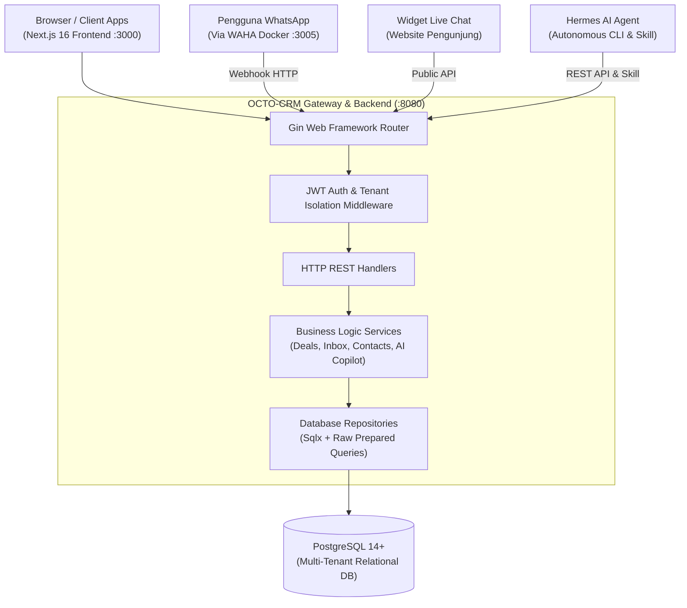
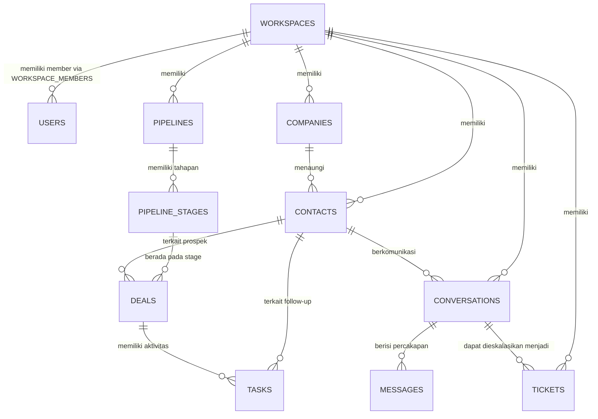
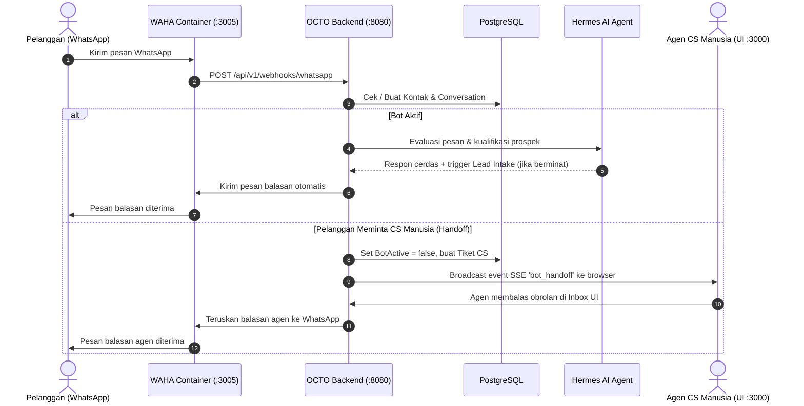
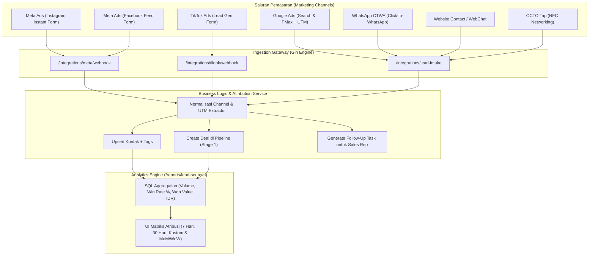
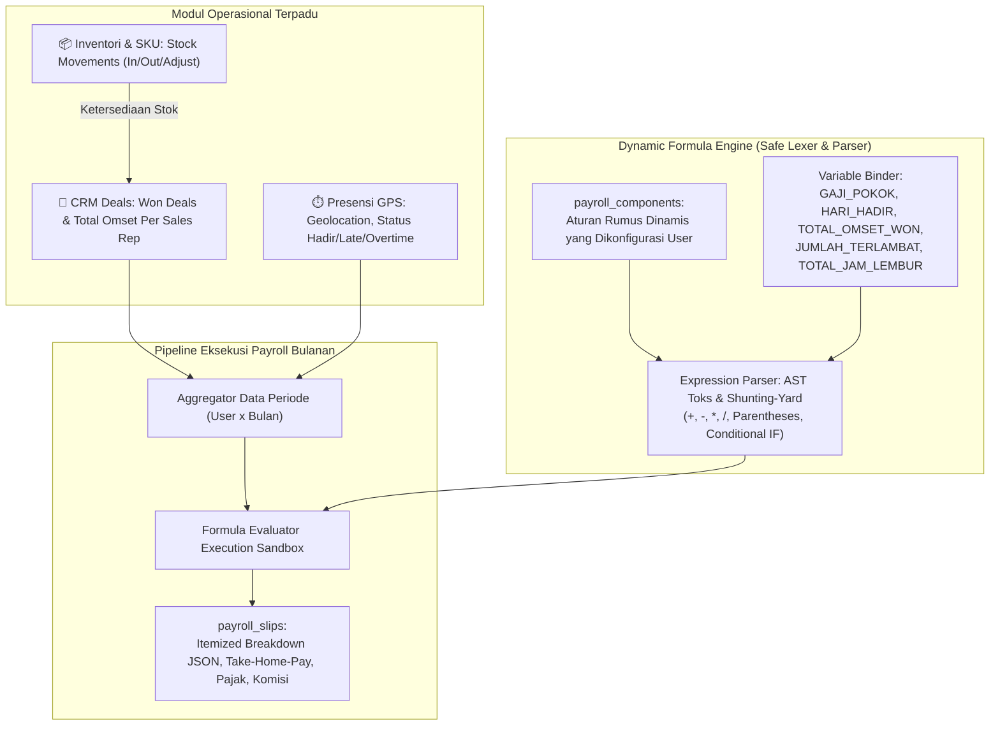
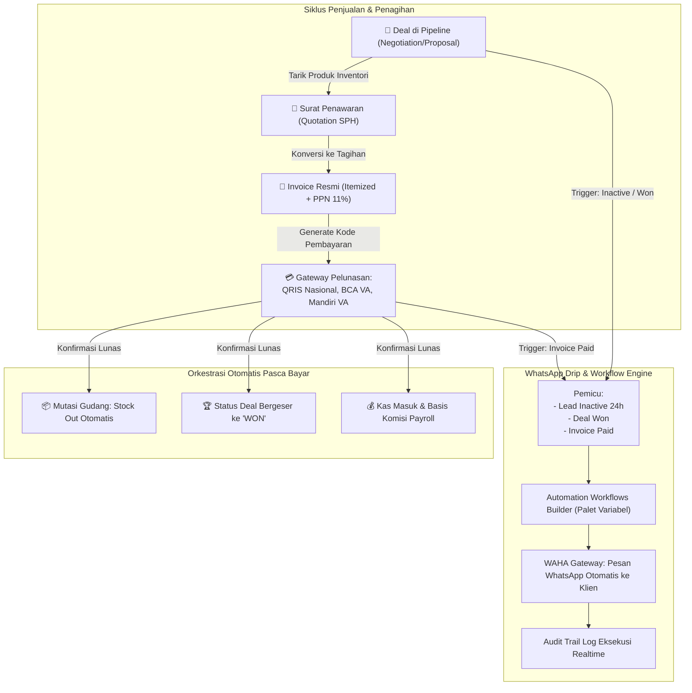

# Dokumentasi Teknis Sistem OCTO-CRM

> **Versi Dokumen:** 2.0  
> **Penulis:** Paige (Technical Writer - BMAD Team)  
> **Target Audiens:** Software Engineer, DevOps, System Architect, dan Tim Integrasi

---

## 1. Arsitektur Sistem Tingkat Tinggi (High-Level Architecture)

OCTO-CRM dirancang menggunakan pola **Clean Architecture** pada sisi backend dan **Server & Client Components Next.js 16** pada sisi frontend, memastikan pemisahan tanggung jawab (*separation of concerns*) yang ketat, isolasi multi-tenant yang aman, dan kemudahan skalabilitas.



---

## 2. Rincian Tech Stack & Dependensi

| Layer | Komponen / Framework | Keterangan & Versi |
|---|---|---|
| **Frontend** | **Next.js 16** (App Router) | React 19, TypeScript 5, Tailwind CSS v4, Lucide Icons |
| **Backend** | **Golang 1.22+** | Gin Gonic v1.12, Sqlx v1.4, JWT v5, Bcrypt |
| **Database** | **PostgreSQL 14+** | Skema relasional, UUID v4 / v7, JSONB custom fields |
| **Messaging Gateway** | **WAHA (WhatsApp HTTP API)** | Dockerized headless WhatsApp Web engine (ARM/AMD64) |
| **AI Agent & Copilot** | **Hermes Agent (Nous Research)** | Autonomous tool-calling agent via REST API & local skills |
| **Email Transaksional**| **Brevo / SMTP Relay** | Port 587 / 2525 REST & SMTP delivery |

---

## 3. Skema Database & Relasi Entitas Utama (ERD)



### Konvensi Tabel:
- **Primary Key:** Selalu menggunakan tipe `UUID` untuk menghindari ID enumeration attack.
- **Tenant Boundary:** Setiap tabel inti memiliki kolom `workspace_id UUID NOT NULL REFERENCES workspaces(id) ON DELETE CASCADE`.
- **Audit Trail:** Kolom `created_at` dan `updated_at` bertipe `TIMESTAMPTZ` secara seragam.

---

## 4. Keamanan & Boundary Otorisasi (Security & RBAC)

Sistem menerapkan model otorisasi berlapis:

1. **Authentication Layer (`middleware.AuthMiddleware`):**
   - Memvalidasi token JWT `Bearer <token>` pada setiap *header*.
   - Mengekstrak `user_id` dan memverifikasi masa berlaku (*expiration 168 jam*).
2. **Tenant Boundary (`middleware.WorkspaceMiddleware`):**
   - Memastikan bahwa pengguna yang terautentikasi benar-benar terdaftar sebagai anggota aktif di `workspace_id` yang tertera pada path URL.
   - Menghentikan akses lintas tenant (*Cross-Tenant Data Leakage*) dengan kode `403 Forbidden`.
3. **Role-Based Access Control (RBAC):**
   - `owner`: Kuasa penuh terhadap konfigurasi workspace, tagihan, dan anggota.
   - `admin`: Manajemen operasional, konfigurasi bot, import/export data.
   - `supervisor`: Pengawasan percakapan, takeover chat agen, pemantauan workload CS.
   - `sales` / `support`: Akses terfokus pada prospek (Pre-Sales) atau tiket bantuan (After-Sales).
   - `member`: Akses baca/tulis data dasar harian.

---

## 5. Alur Kerja Omnichannel & AI Copilot



### 5.2 Alur Arsitektur Multi-Channel Lead Ingestion & Attribution Engine



### 5.3 Arsitektur Unified Business Operations (Inventori, Presensi GPS, & Dynamic Formula Engine)



### 5.4 Arsitektur Penawaran, Invoice, QRIS Payment Gateway & Drip Marketing Automations



---

## 6. Prosedur Pemeliharaan & Runbook Operasional

### Menjalankan Backend:
```bash
cd backend
go run cmd/api/main.go
# Atau build binary mandiri:
go build -o bin/octo-backend cmd/api/main.go && ./bin/octo-backend
```

### Menjalankan Migrasi Database:
```bash
# Periksa status
go run backend/cmd/migrate/main.go -cmd status
# Jalankan migrasi baru
go run backend/cmd/migrate/main.go -cmd up
```

### Menjalankan Frontend:
```bash
cd frontend
npm run dev     # Mode development (:3000)
# Mode produksi:
npm run build && npm run start
```

### Menjalankan Gateway WhatsApp (WAHA):
```bash
docker compose -f docker-compose.waha.yml up -d
# Akses dashboard WAHA di: http://localhost:3005/dashboard
```
